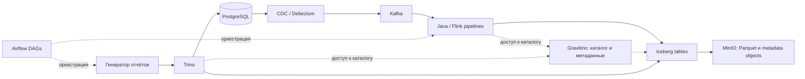

**Подготовка к интервью Streaming Data Engineer — 01.tech**

Материал от 24 сентября 2026 года. Основа — описанный вами банковский опыт и текст вакансии. Технические объяснения проверены по первичным источникам. Где устройство вашего проекта неизвестно, ниже приведён вариант рассуждения, а не утверждение о вашей реализации. Spark-сценарии — предложения для обсуждения, не выполненная вами работа.

**1. Позиционирование и короткий рассказ**

Основная линия: проектирование Java-платформы генерации банковских отчётов, практическая работа с чтением/записью во Flink и оптимизация SQL. Для вакансии особенно релевантно сочетание ingestion в Iceberg с разработкой расширяемой платформы, надёжной очереди и observability. Глубокий production-опыт stateful Flink пока не заявлен; знания об этих механизмах ниже отделены от личного опыта.

Вариант рассказа на 1,5–2 минуты:

> Я работал в банке над контуром подготовки финансовой отчётности для ЦБ. Данные PostgreSQL поступали через CDC с Debezium; в контуре использовалась Kafka. Во Flink я лично реализовывал чтение и запись данных в аналитический слой с Iceberg, Parquet и MinIO. Для SQL-доступа к Iceberg и PostgreSQL использовали Trino, для управления метаданными — Gravitino.
>
> Основной мой вклад — архитектура и разработка Java-платформы генерации отчётов. Я разделил её на API, worker-сервисы и общий инфраструктурный слой. Реализовал очередь на PostgreSQL с FOR UPDATE SKIP LOCKED, lease, heartbeat, retry и backoff, а также пул долгоживущих workers с восстановлением после сбоев. Для разных типов отчётов использовал Strategy и Registry, чтобы новые сценарии подключались без изменения центральной логики.
>
> Также реализовал интеграцию с Airflow: запуск, мониторинг и идемпотентную синхронизацию DAG runs. Отвечал за обработку артефактов, загрузку файлов в MinIO, проверки качества и наблюдаемость. Отдельно оптимизировал SQL в отчётах: анализировал запросы и медленные joins, что сократило время формирования отчётности.
>
> Проект был разделён на Java/Flink pipelines, генератор отчётов и Airflow DAGs. В вашей вакансии мне особенно интересна разработка общего streaming framework: я уже решал задачи выделения общего runtime, расширяемых обработчиков и единых механизмов надёжности. Хочу применять этот опыт к развитию платформы потоковой обработки.

Не утверждайте, что лично проектировали весь lakehouse или уже создали полноценный streaming framework: вы спроектировали платформу отчётов и её механизмы выполнения. Это сильный и конкретный опыт без расширения зоны ответственности. Для SQL нужно подготовить один реальный пример с причиной и результатом.

Ультракороткая версия:

> Я спроектировал Java-платформу банковской отчётности: API, workers, надёжная очередь на PostgreSQL, расширяемые обработчики, Airflow и observability. Работал с CDC/Debezium, писал чтение и запись во Flink для Iceberg-контура и оптимизировал SQL через Trino. Хочу применять опыт платформенной разработки к общему streaming framework.

**2. Что подтверждено и что ещё нужно восстановить**

| Подтверждено вашим описанием | Пока не установлено |
| --- | --- |
| PostgreSQL CDC/Debezium, Kafka в контуре | Точное развёртывание и настройки connector, ваша роль в его эксплуатации |
| Лично реализованные чтение и запись во Flink | Конкретный API и sink mode; joins, state и windows рассматриваем как расширения |
| Iceberg, Parquet, MinIO/S3 и Gravitino | Тип каталога, версии, режимы append/upsert, partition spec |
| SKIP LOCKED, leases, heartbeat, retry/backoff, восстановление workers | Fencing, защита внешних эффектов и детали обработки неизвестного результата операции |
| Оптимизация SQL, работа с Trino и PostgreSQL | Конкретные планы, изменения и измерения до/после |
| Запуск и мониторинг Airflow, идемпотентная синхронизация DAG runs | Конкретные бизнес-ключи и границы повторов между компонентами |
| API/worker/infrastructure, Strategy/Registry, артефакты, метрики и checks | Измерения до/после, характер fail-soft и политика допуска отчёта к публикации |

Не переносите в рассказ производственные объёмы из вакансии или идеи симулятора. 100+ млн пользователей — аудитория продуктов работодателя. 25 000 транзакций и 3 000 клиентов из предыдущего обсуждения — параметры учебной платформы, а не сведения о вашей банковской системе.

Формулировки для резюме с акцентом на вакансию:

- Спроектировал модульную Java-платформу банковской отчётности с разделением API, worker-сервисов и инфраструктурного слоя; внедрил расширяемые обработчики на Strategy/Registry.
- Реализовал чтение и запись данных во Flink в контуре PostgreSQL CDC/Debezium, Kafka и Iceberg/Parquet в MinIO.
- Разработал очередь фоновых задач на PostgreSQL с FOR UPDATE SKIP LOCKED, lease/heartbeat, retry/backoff и восстановлением долгоживущих workers.
- Реализовал запуск, мониторинг и идемпотентную синхронизацию Airflow DAG runs, обработку отчётных артефактов и загрузку в MinIO.
- Внедрил бизнес-метрики, фазовые тайминги, структурированные логи, MDC в асинхронном коде и автоматические проверки качества отчётов.
- Оптимизировал SQL-запросы генератора отчётов по результатам анализа выполнения и медленных joins, сократив время формирования отчётности.

**3. Как объяснить архитектуру**

Это схема ролей компонентов с типовым маршрутом PostgreSQL → Debezium → Kafka → Flink. CDC/Debezium подтверждён вами; точную топологию connector, подключения каталога и управления jobs нужно сверить с проектом.



| Компонент | Как объяснять роль |
| --- | --- |
| PostgreSQL | Операционный источник; также хранение управляющих записей вашего task processor |
| Kafka | Партиционированный журнал событий, развязывающий producer и consumers, позволяющий replay |
| Flink | Вычисления над потоком или ограниченным входом, управление состоянием и восстановлением |
| Parquet | Колоночный формат файлов данных |
| Iceberg | Табличная структура поверх файлов: schema, snapshots, manifests и правила изменения таблицы |
| MinIO / S3 API | Физическое объектное хранилище, к которому обращаются движки |
| Gravitino | Управление метаданными и каталогами; конкретный Iceberg endpoint зависит от конфигурации |
| Trino | Распределённый SQL-движок, читающий источники через connectors |
| Airflow | Оркестрация зависимостей, расписаний и конечных работ |
| Task processor | Ваш механизм жизненного цикла прикладных задач и распределения между workers |

Не перечисляйте Gravitino, MinIO и Iceberg как три последовательных места, куда «перекладываются» данные. Gravitino находится прежде всего в пути управления метаданными. Движок получает сведения о таблице и читает/пишет объекты в storage. Gravitino может предоставлять Iceberg REST Catalog; само наличие Gravitino в проекте ещё не доказывает, что у вас использовали именно этот режим. [Gravitino Iceberg REST service](https://github.com/apache/gravitino/blob/main/docs/iceberg-rest-service.md).

MinIO с S3 API не означает использование AWS. Не нужно переносить рекомендации по выбору новых продуктов из исследования симулятора на рассказ об исторической архитектуре банка.

Три проекта удобно объяснить через границы ответственности: pipelines отвечают за подготовку данных; генератор — за правила и артефакты отчётов; DAGs — за порядок запуска. Утверждать независимые команды, релизы или конкретные контракты можно только если так было.

**4. Три истории, которые стоит подготовить**

История task processor: какая проблема существовала → почему нужен был общий исполнитель → ваша state machine и распределение → поведение при отказе → фактический результат. Восстановите, что именно было задачей: отчёт, SQL-запрос, запуск pipeline или другое. Без этого решение будет звучать абстрактно.

История SQL: какой отчёт тормозил → какой узел плана был проблемой → как определили причину → что изменили → как проверили эквивалентность и время. Нужны engine, тип join, масштабы обеих сторон и хотя бы приблизительный измеренный результат, если он сохранился.

История надёжности pipeline: реальный сбой → как обнаружили → какой прогресс был сохранён → как восстановились → какая защита появилась. Пока конкретный инцидент не назван, не выдавайте сценарии ниже за ваш production-опыт.

Для каждой истории достаточно пяти заметок: проблема, личная ответственность, решение, компромисс, результат. Слова «мы» оставьте для архитектуры команды; «я» — для действий, которые действительно выполняли.

**5. Flink: вопросы, на которые нужно отвечать уверенно**

**Чем stateful отличается от stateless?** Stateless-преобразование не требует истории между событиями: проверить поле, преобразовать валютный код. Stateful хранит данные между событиями: сумму операций по клиенту, последнее событие, множество ID для дедупликации. Пример: лимит числа операций клиента за пять минут требует истории. [Flink stateful processing](https://nightlies.apache.org/flink/flink-docs-stable/docs/concepts/stateful-stream-processing/).

**Что делает keyBy?** Перераспределяет события по ключу так, чтобы state для одного ключа обрабатывался соответствующим subtask. Keyed state доступен в контексте текущего ключа. Обычный HashMap в Java-объекте сам по себе не получает гарантии managed state. Рескейлинг требует корректного переноса состояния; один горячий ключ может ограничивать параллелизм. [Working with State](https://nightlies.apache.org/flink/flink-docs-stable/docs/dev/datastream/fault-tolerance/state/).

**Что хранится в checkpoint?** Согласованная точка восстановления: состояния операторов и позиции источников, а не просто Kafka consumer offset. После падения возможна повторная физическая обработка событий; задача exactly-once state semantics — не учесть их второй раз в восстановленном состоянии. Для внешнего результата дополнительно нужен совместимый sink. [Flink fault tolerance](https://nightlies.apache.org/flink/flink-docs-stable/docs/learn-flink/fault_tolerance/).

**Checkpoint и savepoint?** Checkpoints используются для восстановления, savepoints — для управляемых операций, например обновления приложения. Перенос требует совместимости state и идентификации операторов. Stable operator UIDs помогают сопоставить состояние после изменения графа. Нельзя обещать, что произвольное изменение кода или сериализатора совместимо со старым savepoint. [Flink savepoints](https://nightlies.apache.org/flink/flink-docs-stable/docs/ops/state/savepoints/).

**Event time и processing time?** Первое — время бизнес-события, второе — время обработки движком. Покупка в 23:59, полученная в 00:03, относится к разным дням в зависимости от выбранной семантики. Для банковского расчёта правило бизнес-дня задаётся отдельно, включая timezone и дату проводки.

**Что такое watermark?** Сигнал продвижения event time, позволяющий закрывать окна и ограничивать состояние по выбранной политике опозданий. Он не запрещает поздним событиям прийти. Медленный или пустующий вход может задерживать общий watermark; idleness помогает с неактивными входами, но не доказывает полноту бизнес-данных. [Flink watermarks](https://nightlies.apache.org/flink/flink-docs-stable/docs/dev/datastream/event-time/generating_watermarks/).

**Что делать с поздними финансовыми данными?** Для проектного ответа предложите сохранять исходное событие и иметь процедуру корректировки/перерасчёта отчёта. Удалить его из окна и забыть — недостаточно. Политика «поздно для оперативной метрики» не должна означать потерю записи в историческом учёте.

**Что такое backpressure?** Нижележащая стадия не успевает принимать результат, и замедление распространяется вверх. Проверять нужно загрузку операторов, busy/backpressured time, задержки sink, CPU/GC, state и checkpoint duration. Большой Kafka lag — симптом, но не локализация причины. Увеличение parallelism не исправит лимит внешнего сервиса или один горячий ключ. [Flink backpressure](https://nightlies.apache.org/flink/flink-docs-stable/docs/ops/monitoring/back_pressure/).

**Почему растёт state?** Неограниченные ключи/окна, медленное продвижение времени, бесконечная дедупликация или join без ограничений. Для проектного решения оценить число активных ключей × размер состояния × период хранения; отдельно учитывать serialization и служебные расходы. TTL нужно согласовывать с допустимой семантикой: удаление состояния может изменить результат.

**Что ограничивает parallelism?** Чтение Kafka обычно ограничено числом назначаемых partitions, но downstream после перераспределения может иметь иной parallelism. Число зарегистрированных пользователей не равно events/sec и не равно числу одновременно активных ключей. Для оценки нагрузки нужны peak rate, размер сообщения, state cardinality и SLA восстановления.

**Зачем нужны aligned/unaligned checkpoints?** При выравнивании barrier оператор ждёт согласованного положения барьеров по входам. Unaligned checkpoints могут включать данные в каналах и уменьшать задержку checkpoint при backpressure, увеличивая объём сохраняемого состояния. Это инструмент для определённых условий, а не универсальное ускорение. [Flink checkpointing](https://nightlies.apache.org/flink/flink-docs-stable/docs/dev/datastream/fault-tolerance/checkpointing/).

**6. Iceberg, storage и воспроизводимая отчётность**

**Почему недостаточно Parquet?** Отдельный файл не определяет атомарную версию всей таблицы. В Iceberg снимок ссылается на manifests, а те описывают входящие файлы и их метаданные. Читатель работает с определённым состоянием таблицы. Это позволяет обсуждать обновления, версии и эволюцию схемы отдельно от физического формата. [Iceberg specification](https://iceberg.apache.org/spec/).

**Когда данные видны Trino?** Загрузка Parquet в bucket ещё не означает включение файла в таблицу. Нужен успешный commit соответствующей версии. Для Flink sink commit связан с протоколом checkpoints; документация отдельно предупреждает о ситуации, когда checkpoints успешны, а Iceberg commits не продвигаются. Поэтому полезны обе метрики. Конкретные классы и callbacks зависят от версии sink. [Iceberg Flink writes](https://iceberg.apache.org/docs/latest/flink-writes/).

**Что происходит при одновременных writes?** Iceberg использует optimistic concurrency и атомарную публикацию метаданных таблицы через подходящий catalog. При конфликте важны проверка совместимости изменений и retry. Это не делает произвольную операцию над несколькими таблицами общей транзакцией. [Iceberg reliability](https://iceberg.apache.org/docs/latest/reliability/).

**Append или upsert?** Для журнала неизменяемых событий подходит append. Для актуального состояния транзакции нужны правила применения изменений и удаления. В Flink/Iceberg upsert следует учитывать format version, equality fields и ограничения partitioning; не переносить PostgreSQL UPSERT один к одному. [Iceberg Flink upsert](https://iceberg.apache.org/docs/latest/flink-writes/#upsert).

**Что такое hidden partitioning?** Пользователь фильтрует бизнес-поле, а Iceberg использует известное преобразование, например день от timestamp, для выбора файлов. Партиционирование выбирают по чтению, потоку записи и размеру файлов; partition per customer может породить множество маленьких файлов. [Iceberg partitioning](https://iceberg.apache.org/docs/latest/partitioning/).

**Почему бывает много маленьких файлов?** Частые commits, большое число writers и partitions, малый объём на комбинацию writer/partition. Это увеличивает стоимость планирования и чтения. В проектном ответе назовите настройку частоты commits и compaction, затем уточните ограничения по latency и retention.

**Как повторить отчёт через месяц?** Проектное решение: сохранить версию SQL/правил, входные snapshot IDs по каждой таблице, параметры даты и timezone, контрольные суммы, идентификатор запуска и выходной артефакт. Необходимая история должна пережить retention/expiration. Если справочник читается из живого PostgreSQL, его состояние тоже нужно фиксировать или версионировать.

**Как понять, что отчётный день полностью загружен?** Предложите контракт закрытия источников и проверки reconciliation: количества, суммы, допустимые разницы, позиции ingestion и публикация всех нужных таблиц. Один watermark, один checkpoint или состояние Airflow SUCCESS не доказывают бизнес-полноту. Для отчёта по нескольким таблицам нужен согласованный набор версий, а не отдельные случайно выбранные latest snapshots.

Trino поддерживает работу с Iceberg snapshots и метаданными через свой connector, но точные возможности нужно соотносить с версией вашего стека. [Trino Iceberg connector](https://trino.io/docs/current/connector/iceberg.html).

**7. Task processor: ваш основной пример системного проектирования**

Подтверждено: вы реализовали processor, state machine, SKIP LOCKED, leases, heartbeat, retry/backoff, dispatcher и восстановление workers. Далее к подтверждённым механизмам добавлены вопросы о деталях; fencing и согласование внешних side effects пока не подтверждены.

**Почему PostgreSQL?** Возможный аргумент: транзакционные изменения состояния задач, запросы по статусам, история и отсутствие дополнительного брокера для этого типа нагрузки. Компромиссы: polling, contention, индексы, vacuum и ограничения общего экземпляра. Количество бизнес-пользователей не требует хранения каждой их операции в task queue.

**Как два workers не забирают одну задачу?** Claim должен быть атомарным. Распространённый вариант — выбрать и заблокировать готовую запись через `FOR UPDATE SKIP LOCKED`, изменить владельца и lease в той же короткой транзакции, затем выполнять работу после commit. PostgreSQL прямо допускает SKIP LOCKED для очередеподобных таблиц. Не держать row lock весь срок генерации отчёта. [PostgreSQL SELECT locking](https://www.postgresql.org/docs/current/sql-select.html#SQL-FOR-UPDATE-SHARE).

**State machine для обсуждения:** `READY → RUNNING → SUCCEEDED`; временная ошибка: `RUNNING → RETRY_WAIT → READY`; исчерпание попыток/неповторяемая ошибка: `RUNNING → FAILED`. Истечение lease — отдельная причина перехода; повторный запуск требует проверки текущего владельца и версии попытки. Ваши фактические названия статусов могут отличаться.

**Что гарантирует lease?** Только ограниченное по времени право владения в управляющей модели. Lease не убивает процесс. После GC pause или разрыва сети старый worker может ожить, когда новый уже начал работу.

**Как защититься от устаревшего worker?** Для проектного решения хранить возрастающий `lease_epoch`/fencing token. Claim увеличивает epoch. Продление и завершение должны проверять task ID, owner, epoch и допустимое состояние; при строгом lease — также актуальность срока. Изменено ноль строк означает потерю права. Но эта проверка защищает таблицу задач; внешний side effect должен сам отвергать устаревшую попытку либо быть идемпотентным.

Пример проверки завершения, иллюстрация, не код вашего проекта:

```sql
UPDATE tasks
SET state = 'SUCCEEDED', result_ref = :result_ref
WHERE id = :task_id
  AND state = 'RUNNING'
  AND owner_id = :worker_id
  AND lease_epoch = :lease_epoch
  AND lease_until > statement_timestamp();
```

**Что если отчёт создан, но статус SUCCEEDED не записан?** После retry работа может выполниться ещё раз. Практический вариант для обсуждения: стабильный бизнес-ключ отчёта, versioned output на попытку и условная публикация ссылки только действующим владельцем. Не позволять старому worker перезаписать общий путь файла. Для вызова внешней системы нужен её idempotency key или другой протокол согласования. В общем случае обещать exactly-once execution нельзя.

**Как продлевать lease?** Heartbeat с запасом относительно срока, проверкой ownership и явным действием при потере lease. Время сравнивать согласованно, предпочтительно на стороне БД. Не запускать heartbeat в полностью забитом executor длительных задач. Размеры TTL, heartbeat и допустимого простоя определяются нагрузкой и отказами; произвольные числа не являются хорошим обоснованием.

**Retries:** временные и постоянные ошибки различать; хранить attempt, next_run_at и reason; использовать ограниченный backoff с jitter. Повтор не должен бесконечно занимать очередь. После timeout исходный SQL или удалённая job могут всё ещё работать — нужен известный query/job ID и возможность reconciliation/cancellation, а не слепой повтор.

**Dispatcher:** уточните, назначал ли он worker заранее или workers забирали доступные задачи. В обоих вариантах важны атомарность назначения, capacity, fairness, обработка падения dispatcher и отсутствие единственного незащищённого владельца в памяти. Название dispatcher не определяет алгоритм распределения.

**Почему не один Airflow?** Возможное обоснование: DAG отвечает за расписание и крупные зависимости, processor — за конкретные прикладные задачи и их жизненный цикл. Но граница должна решать реальную потребность. На интервью объясните, что не дублировали два независимых механизма без контракта. Если Airflow повторно отправляет задание, idempotency key должен предотвращать создание второй логической работы.

**Что проверять тестами:** конкурентный claim; падение после claim; потерю heartbeat; оживление старого owner; side effect до commit статуса; потерю ответа БД после успешного commit; poison task; перезапуск dispatcher; graceful shutdown. Это список для оценки вашей реализации, не заявка, что все эти тесты уже были.

**Java-подготовка:** bounded executor и queue, rejection policy, thread safety общего состояния, connection pool, `InterruptedException` и кооперативная отмена, закрытие ресурсов, immutable DTO, `equals/hashCode` для ключей, `BigDecimal` и rounding для денег. Неограниченная очередь может скрыть перегрузку и привести к исчерпанию памяти. [Java ThreadPoolExecutor](https://docs.oracle.com/en/java/javase/21/docs/api/java.base/java/util/concurrent/ThreadPoolExecutor.html).

**8. Как подробно рассказать про SQL-оптимизацию**

Базовая формулировка: «Я начинал с плана и фактических объёмов на операторах, проверял место выполнения join, кардинальность и объём чтения/обмена. После изменения проверял и результат, и время на сопоставимом наборе». Используйте её в прошедшем времени только для действительно сделанных шагов.

В Trino `EXPLAIN ANALYZE` выполняет запрос и показывает фактические статистики. Полезно смотреть input/output rows, CPU и wall time, blocked time, распределение нагрузки между tasks. Не складывать время параллельных узлов как последовательные секунды. [Trino EXPLAIN ANALYZE](https://trino.io/docs/current/sql/explain-analyze.html).

Broadcast join реплицирует build-сторону по участвующим узлам: хорош для достаточно малого набора, но опасен большим потреблением памяти. Partitioned join перераспределяет данные по ключу: помогает большим входам, но требует сетевого обмена. Оценки размера и статистики влияют на выбор; один hot key создаёт дисбаланс. [Trino cost-based optimization](https://trino.io/docs/current/optimizer/cost-based-optimizations.html).

Если запрос соединяет Iceberg и PostgreSQL, нельзя предполагать, что весь join ушёл в PostgreSQL. Проверяют конкретный plan и connector pushdown. Для join внутри одного совместимого источника pushdown иногда возможен; для разных систем обычно остаётся распределённая работа движка. Индекс PostgreSQL помогает той части, которую реально выполняет PostgreSQL. [Trino PostgreSQL connector](https://trino.io/docs/current/connector/postgresql.html), [pushdown](https://trino.io/docs/current/optimizer/pushdown.html).

Dynamic filtering получает значения с build-стороны join и может уменьшать чтение другой стороны через поддерживающий connector. Это не означает, что любой WHERE автоматически превратился в идеальное partition pruning. [Trino dynamic filtering](https://trino.io/docs/current/admin/dynamic-filtering.html).

В PostgreSQL полезны `EXPLAIN (ANALYZE, BUFFERS)`, расхождение estimated/actual rows, число loops, чтение buffers, disk sort и hash batches. Nested Loop не плох сам по себе: при малом outer и индексном inner он может быть лучшим вариантом. `EXPLAIN ANALYZE` действительно исполняет запрос, что особенно важно для изменяющих statements. [PostgreSQL EXPLAIN](https://www.postgresql.org/docs/current/using-explain.html).

Учебный пример, не ваш установленный кейс: транзакции соединяются с историческим справочником клиентов только по customer_id. У клиента несколько версий, строки размножаются, суммы неверны и join дорог. Исправление — выбрать нужную версию или добавить as-of условие времени. Такая оптимизация начинается с семантики; просто DISTINCT может скрыть ошибку и добавить стоимость.

Другой возможный пример: отчёт за один день сканирует длинную историю. Проверить фактическое pruning, типы и предикаты; уменьшить набор до join и читать нужные колонки. CTE само по себе не гарантирует материализацию или более ранний фильтр. Группировку до join применять только если сохраняются бизнес-смысл и требуемая детализация.

Для проверки эквивалентности сравнить бизнес-ключи, числа строк, дубли, суммы по валютам/датам, NULL и граничные даты; при необходимости `EXCEPT ALL` в обе стороны. Сравнить одинаковые snapshots и условия выполнения, учесть кэш и конкуренцию. Ускорение с неверной суммой для финансового отчёта не является результатом.

**9. Spark: сценарий, который естественно дополняет ваш проект**

Не называйте это прошлым опытом, если не реализовывали. Формулировка: «В нашем контуре я вижу следующий сценарий применения Spark».

Основной вариант — массовый перерасчёт и сверка отчётных витрин после изменения правил за квартал/год. Flink продолжает ingestion, Spark читает зафиксированные Iceberg snapshots, соединяет транзакции с историческими клиентскими данными, считает показатели, сравнивает с предыдущей версией и пишет новый versioned результат. Airflow запускает расчёт и проверки. Точные версии справочников и курс валют входят в контракт расчёта.

Почему Spark: крупная batch-работа, сложные joins/агрегаты, материализация повторно используемого результата и перенос SQL/DataFrame-логики между перерасчётом и инкрементами. Но Trino тоже способен выполнять большие запросы: решение принимать по требованиям к процессу, ресурсной изоляции, стоимости и измерениям, а не по правилу «большие данные значит Spark».

Для вакансии добавьте потоковый вариант — предварительные пятиминутные финансовые показатели через Spark Structured Streaming.

```text
Kafka: неизменяемые события проведённых операций и сторно
    → Spark Structured Streaming, отдельный checkpoint
    → явная схема, проверки, дедупликация в заданном горизонте
    → event-time окна по валюте и бизнес-измерениям
    → Iceberg: предварительные показатели
    → Trino / генератор отчётов
```

Допущения сценария: корректировки выражены отдельными signed events, а не произвольными CDC UPDATE; единица учёта заранее определена; валюты не смешиваются; late data сохраняются в исходном журнале. Если источник — CDC актуального состояния, нельзя просто суммировать каждую новую версию: нужна retract/upsert-семантика.

Micro-batch trigger определяет частоту обработки, но не обязан совпадать с размером event-time окна. Например, обработка раз в минуту и пятиминутное окно с допустимым опозданием — три разных параметра. В append mode финальный результат окна появляется после продвижения watermark, поэтому не обещайте одновременно ранний результат и отсутствие обновлений.

Для ранних обновляемых агрегатов можно рассмотреть `foreachBatch` и детерминированный MERGE абсолютных итогов по ключу окна. Повтор должен записать тот же результат, а не повторно прибавить дельту. Сам callback имеет at-least-once семантику; межтабличные эффекты и повтор после потери checkpoint требуют дополнительного контракта. [Spark Structured Streaming API](https://spark.apache.org/docs/latest/streaming/apis-on-dataframes-and-datasets.html), [Spark writes в Iceberg](https://iceberg.apache.org/docs/latest/spark-writes/).

Прямой Iceberg streaming sink поддерживает определённые output modes; нельзя автоматически направить произвольный update stream в append sink. Чтение изменяемой Iceberg-таблицы через streaming также не равно универсальному CDC: append snapshots и overwrite/delete имеют разные ограничения. [Iceberg Structured Streaming](https://iceberg.apache.org/docs/latest/spark-structured-streaming/).

Поздние корректировки за пределами live-state обрабатывает batch-сверка из сохранённого raw. Только после completeness checks и закрытия периода предварительный результат становится утверждённой версией отчёта. Это предложенный контракт, а не описание вашей старой системы.

**Что знать про Spark к этому сценарию:** driver планирует, executors выполняют; transformations ленивые, action запускает вычисления; shuffle возникает при перераспределении, например groupBy и крупных joins. Partition в Spark execution и partition Iceberg-таблицы — разные понятия. `collect()` переносит результат на driver. Built-in выражения позволяют оптимизатору видеть логику лучше, чем произвольный UDF. Подготовьте объяснение broadcast, skew, AQE и причины spill. [Spark SQL tuning](https://spark.apache.org/docs/latest/sql-performance-tuning.html).

В Kafka-интеграции Structured Streaming восстановление опирается на checkpoint query; изменение `startingOffsets` не означает произвольный откат уже восстановленного запроса. Ограничение входа на batch помогает контролировать нагрузку. Kafka sink допускает дубликаты, и его нельзя объявлять end-to-end exactly-once без дополнительных механизмов. [Spark Kafka integration](https://spark.apache.org/docs/latest/streaming/structured-streaming-kafka-integration.html).

Сравнивать Flink и Spark лучше по требованиям: управляемое keyed state и timers, event-time semantics, допустимая задержка, существующая SQL/batch-логика, sink, восстановление и операционные расходы. Неверно говорить «Spark умеет только batch» или «Flink не умеет batch». Нельзя обещать численную разницу latency без сопоставимого benchmark.

**10. Как ответить про разработку общего streaming framework**

Вариант ответа на проектный вопрос:

> Начал бы с нескольких повторяющихся pipelines и их требований: источники, контракты событий, state, задержка, sink и восстановление. Выделил бы общие механизмы подключения, конфигурации, обработки ошибок, метрик и deployment, оставив бизнес-преобразования отдельными. Затем проверил бы API на двух-трёх разных задачах и только после этого расширял абстракции.

Обсудить последовательно:

| Область | Что стандартизировать |
| --- | --- |
| Конфигурация | Валидируемая схема, defaults, secrets references, версии |
| События | Schema, key, event time, event ID/version, правила эволюции |
| Connectors | Совместимость, source/sink contracts, обработка retries |
| State | Сериализация, TTL, stable IDs, migration policy |
| Надёжность | Checkpoint policy, restart, replay, ограничения гарантий |
| Ошибки | Некорректные записи отдельно от инфраструктурных ошибок; quarantine с причиной |
| Наблюдаемость | Lag, freshness, throughput, state size, commits, failed records |
| Тестирование | Контрактные тесты, duplicates, out-of-order, crash/recovery |
| Эксплуатация | CI/CD, rollback, savepoints, backfill, quotas и ownership |

Не скрывать все различия Flink и Spark за одним интерфейсом, который обещает одинаковые гарантии. Общими могут быть контракты, конфигурация и контроль, а runtime-specific настройки остаются явными. Если DLQ позволяет pipeline продолжать работу, качество отчёта всё равно должно учитывать пропущенные записи; зелёный job status недостаточен.

При требовании «100+ млн пользователей» сначала уточнить events/sec, peak, размер события, retention, активные ключи, задержку и время восстановления. Архитектура для миллионов редких событий и для тех же пользователей с частым clickstream будет разной.

**11. Kafka, Debezium и ClickHouse — дополнительные темы**

Kafka: порядок ограничен partition; одинаковый business key обычно нужен для последовательной обработки сущности. Kafka offset относится к partition, а не является глобальной временной меткой. Producer idempotence не исключает два семантически одинаковых сообщения с разными event IDs. Kafka transactions сами по себе не охватывают произвольные изменения PostgreSQL или Iceberg. [Kafka design](https://kafka.apache.org/41/design/design/).

Kafka connector во Flink/Spark и Kafka Connect — разные вещи. Connector подключает runtime к Kafka. Kafka Connect — отдельный фреймворк source/sink connectors. Debezium часто разворачивают внутри Connect, но это не значит, что любой Kafka source использует Debezium.

Debezium для PostgreSQL: изучить initial snapshot, WAL/logical decoding, replication slot, publication, позиции восстановления, UPDATE/DELETE и replica identity. Медленно читающий connector может удерживать WAL и создавать нагрузку на диск источника. Если не использовали его лично, сказать: «Мой практический опыт — [ваш механизм]; архитектуру CDC через Debezium понимаю, но production-настройку этого connector не заявляю». [Debezium PostgreSQL](https://debezium.io/documentation/reference/stable/connectors/postgresql.html).

ClickHouse: дополнительный serving-слой для быстрых аналитических запросов — возможное расширение, не обязательная замена lakehouse. Для базовой подготовки понимать колонночное хранение, MergeTree, значение ORDER BY и обработку изменений. У ReplacingMergeTree слияния асинхронны; нельзя считать, что новая вставка мгновенно и навсегда убрала старую строку из всех результатов. [ReplacingMergeTree](https://clickhouse.com/docs/reference/engines/table-engines/mergetree-family/replacingmergetree).

Если Scala или Spark не было в работе: «Мой основной production-язык — Java, практический streaming-опыт связан с Flink. Spark/Scala изучаю и могу обсудить подход и ограничения, но не буду приравнивать это к опыту эксплуатации». Использовать эту формулировку только если она соответствует действительности.

**12. Самопроверка и план на вечер**

Приоритетная последовательность примерно на три часа:

1. 25 минут: проговорить вступление и нарисовать реальную архитектуру; убрать все неподтверждённые детали.
2. 40 минут: task processor — claim, lease, старый worker, side effects, граница retries с Airflow.
3. 40 минут: Flink — state, checkpoint, Kafka offsets, watermark, backpressure и восстановление.
4. 30 минут: Iceberg/Gravitino/MinIO/Trino — путь metadata и файлов, commits, согласованность отчёта.
5. 25 минут: восстановить один реальный SQL-кейс и критерии проверки результата.
6. 20 минут: Spark-сценарий, проектирование framework и вопросы команде.

Проверочные вопросы, отвечать вслух по 1–2 минуты:

1. Проведите одну транзакцию от PostgreSQL/Kafka до строки отчёта.
2. Что лично вы писали во Flink и что настраивала другая команда?
3. Что случится после падения между записью файла и commit Iceberg?
4. Почему checkpoint SUCCESS не обязательно означает свежий отчёт?
5. Что будет со старым worker после окончания lease?
6. Как повторить задачу, если внешний результат уже создан?
7. Зачем были одновременно processor и Airflow?
8. Чем бизнес-дубликат отличается от replay после checkpoint?
9. Почему join оказался медленным и где он выполнялся?
10. Как проверили, что оптимизация не изменила финансовый результат?
11. Какой snapshot справочника должен участвовать в историческом отчёте?
12. Почему watermark не равен закрытию банковского дня?
13. Где вы бы применили Spark и как измерили бы пользу?
14. Какие механизмы вынесли бы в общий framework?
15. Какие цифры нагрузки вам нужны, кроме числа пользователей?

Полезные вопросы работодателю: кто пользователи framework и какие pipelines уже есть; основной runtime и причины поддержки второго; реальные throughput/latency/state; что является главным sink; самые частые production-инциденты; ответственность за on-call; ожидаемый результат первых трёх месяцев.

**13. Что уточнить для окончательной версии вашего рассказа**

- Как настраивали подтверждённый CDC/Debezium: initial snapshot, новые изменения, ваш личный вклад в connector.
- Каким API реализовали чтение/запись во Flink и каким был sink mode; преобразования, joins, state и windows пока не являются заявленным личным опытом.
- Где находились checkpoint storage и state backend; какие были restart/retention параметры и версии.
- Какой режим Gravitino/catalog использовался, как подключались Trino и Flink.
- Детали claim/lease/heartbeat в processor, защита от старого владельца и повторного внешнего результата.
- Кто инициировал задачи и как Airflow взаимодействовал с processor и отчётным сервисом.
- Один реальный SQL до/после и один инцидент; любые подтверждаемые масштабы и измерения.
- Фактический уровень Spark, Scala, ClickHouse и Debezium.

**14. Преобразования, joins, state, окна и обновления — на вашем банковском примере**

Эта часть отвечает на ваш дополнительный вопрос. Лично вы подтвердили чтение/запись во Flink. Дальнейшие операции — примеры того, как можно развивать этот pipeline, и материал для технического обсуждения.

Возьмём транзакцию `tx-42`: клиент `customer-7`, сумма 1 000 RUB, сначала `PENDING`, затем `POSTED`; позже сумму исправили на 900 RUB. Клиентский сегмент тоже может меняться со временем. Числа и ID здесь учебные.

**Преобразование: привести вход к контракту.** После десериализации CDC извлечь идентификаторы и время, привести сумму к Decimal, нормализовать коды валют, вычислить бизнес-дату по согласованной timezone. Неверную запись отправить в quarantine с причиной и сохранить исходный payload. Одно событие обрабатывается без истории, поэтому такая операция может быть stateless. Типичный Java API — `map`, `flatMap`, `filter` либо процессная функция для нескольких выходов.

Тонкость: `filter(status == POSTED)` над плоскими after-снимками может быть неверным для CDC. Если ранее проведённая запись стала отменённой, её прежний вклад нужно убрать. Нельзя просто отфильтровать новое состояние и оставить старый результат. Поэтому после изменения типа потока с append-only на changelog меняется и смысл простых операций.

**Join: обогатить транзакцию атрибутами клиента.** У `tx-42` есть только customer_id, но отчёту нужны сегмент и резидентность. Вопрос начинается с бизнес-семантики: нужны атрибуты сейчас, на дату операции или на дату отчёта? Это может давать три разных корректных ответа для разных отчётов.

| Вариант | Когда рассматривать | Что может пойти не так |
| --- | --- | --- |
| Lookup внешнего справочника | Нужно актуальное значение на момент обработки | Нагрузка на PostgreSQL, кеш, различия при replay |
| Event-time temporal join | Нужна версия клиента на время транзакции | Требуются история, ключ и согласованная временная семантика |
| Regular streaming join | Результат должен обновляться вслед за изменениями обеих таблиц | Объём state и большая волна обновлений результатов |
| Interval join | Нужно сопоставить два потока событий, близких по времени | Не подменять им исторический справочник; нужны условия времени |

Пример temporal-смысла: операция в 10:00 должна получить сегмент, действующий в 10:00, даже если обработана после смены сегмента в 12:00. Но event-time join не решает автоматически задним числом внесённое исправление бизнес-истории: различайте время записи изменения в источнике и effective time атрибута. [Flink joins](https://nightlies.apache.org/flink/flink-docs-stable/docs/sql/reference/queries/joins/).

**State: помнить предыдущую версию транзакции.** После `keyBy(transaction_id)` можно хранить последнее принятое состояние и версию изменения. Оно позволяет понять, какой вклад отозвать при UPDATE, и не применять заведомо устаревшую версию. Для CDC лучше использовать поддерживаемую changelog-модель, если она покрывает задачу, а не писать всю нормализацию вручную.

Определение порядка требует source-aware версии: произвольный timestamp получения недостаточен. Kafka offset сравним внутри одной partition; LSN не всегда сам по себе уникально идентифицирует каждое бизнес-событие. Primary key, source position и transaction metadata нужно трактовать согласно конкретному connector. Если хранить только transaction_id как «уже видели», настоящие UPDATE будут ошибочно удаляться как дубликаты.

**Другой stateful-пример — антифрод по клиенту.** После `keyBy(customer_id)` хранить число/сумму операций за короткий период или последнее устройство. Для сложного правила можно использовать managed state и timers. Если хочется разделить горячего клиента на несколько ключей ради throughput, потребуется отдельно доказать, что объединение частичных результатов сохраняет правило.

**Окна: ограничить агрегат по времени.** Tumbling 5 минут даёт неперекрывающиеся интервалы, например `[10:00, 10:05)` и `[10:05, 10:10)`. Sliding 5 минут с шагом 1 минута позволяет обновлять показатель чаще; одна операция участвует в нескольких окнах. Session windows группируют активность с заданным разрывом тишины. Примеры: операционный оборот за пять минут, активность клиента или всплеск отказов. [Flink windows](https://nightlies.apache.org/flink/flink-docs-stable/docs/dev/datastream/operators/windows/).

Для отчётного дня понятие «сутки» нужно согласовать с timezone и датой бухгалтерского признания, а не автоматически взять UTC-окно. При поздних событиях определить, допускаются ли повторные обновления результата, side output или отдельный перерасчёт. Для DataStream нужны соответствующие window/late-data механизмы; для SQL поведение зависит от оператора. Синтаксис и поддержка changelog-входа проверяются для выбранной версии.

**Обновления: CDC-событие не равно новой покупке.** В Debezium есть тип операции и данные before/after. Flink SQL/Table API умеет интерпретировать Debezium как изменения динамической таблицы. В DataStream нельзя ожидать этого от обычного POJO или `map`: нужно явно сохранить семантику изменений и передать её совместимому sink. [Flink Debezium format](https://nightlies.apache.org/flink/flink-docs-stable/docs/connectors/table/formats/debezium/).

Как меняется вклад `tx-42` в проведённый оборот:

| Состояние | Требуемый эффект для агрегата |
| --- | ---: |
| PENDING, 1 000 RUB | 0 |
| POSTED, 1 000 RUB | +1 000 |
| POSTED, исправлено на 900 RUB | −1 000 + 900 |
| Повтор того же изменения | 0 |

Итог — 900 RUB. В lakehouse можно иметь одновременно append-only raw-журнал всех CDC-событий и upsert-таблицу актуального состояния. Они решают разные задачи: аудит/replay и удобное аналитическое чтение. Для DELETE, исправлений ключа/partition и реплик исходного изменения должны быть отдельные правила.

Разница двух видов повторов: повтор выполнения Flink после checkpoint и повторное CDC-событие, уже помещённое Debezium в Kafka, происходят на разных участках пути. Настройка exactly-once Flink не превращает любые входные бизнес-дубликаты в уникальные события. Нужны соответствующие контракты connector и нормализации.

Как сказать об этом на интервью:

> В моих jobs основной личный объём был в source/sink. Если расширять этот pipeline преобразованиями, я бы начал с контракта CDC: отделил журнал изменений от актуального состояния, определил ключ и правила применения UPDATE/DELETE. Для обогащения уточнил бы, нужна ли историческая версия клиента. Для оперативных агрегатов выбрал бы event-time окна и явно задал политику поздних данных.

**15. Как использовать дополнительные подробности о вашей Java-платформе**

Ваши десять пунктов лучше свернуть в три истории. Вступление не должно превращаться в перечисление всех инструментов статического анализа.

Первая история — надёжный runtime: PostgreSQL queue, leases, heartbeat, retries, долгоживущие workers и Airflow. Вторая — расширяемость: модульная архитектура, Strategy/Registry, единый lifecycle обработки и контракт API. Третья — эксплуатация и результат: артефакты, качество отчётов, метрики, логи и оптимизация запросов.

**Strategy/Registry.** Подготовьте конкретный путь добавления нового типа отчёта. Например: реализация handler → регистрация типа → конфигурация → тесты. Подтвердите, что действительно оставалось общим: claim, logging, retry, upload, checks. Возможные follow-up: как обнаруживали дубли ключей Registry; были ли handlers singleton/thread-safe; как версионировали payload; что считалось retryable error. Не приписывайте себе конкретный интерфейс `ReportHandler`, если он назывался или работал иначе.

**Артефакты и MinIO.** Подготовьте сценарий «файл загрузился, запись metadata не сохранилась» и обратный. В качестве развития можно предложить состояния PENDING/UPLOADED/READY, уникальный object key на попытку, checksum, условную публикацию и reconciliation. PostgreSQL-транзакция сама по себе не включает PUT объекта. Это особенно связано с lease: старый worker не должен перезаписать уже опубликованный актуальный результат.

**MDC в асинхронном коде.** Восстановите, где захватывали контекст и как переносили его в executor. Контекст нужно восстанавливать/очищать после выполнения, чтобы переиспользуемый thread не получил task ID предыдущей работы. Расскажите, какие идентификаторы связывали задачу, отчёт, DAG run, SQL query и объект в MinIO. Упоминайте только фактически введённые поля.

**Бизнес-метрики и фазовые тайминги.** Вы уже измеряли этапы — это сильный источник конкретного SQL-кейса. Восстановите, как отделяли ожидание очереди, получение данных, вычисление, рендер документа и загрузку. Общее время отчёта и время SQL не обязательно улучшаются на одинаковый процент. Для framework назовите стандартные labels, но учитывайте cardinality: уникальный task ID удобен в логах, обычно не в labels всех метрик.

**Fail-soft.** Важно объяснить, какая ошибка не останавливала процесс: сбой дополнительного checker, обнаруженная аномалия или инфраструктурная ошибка. ERROR/UNKNOWN проверки не должны незаметно становиться PASS. Возможное разделение: генерация артефакта завершена, проверка не выполнена, публикация ограничена отдельной политикой. Если у вас было иначе, расскажите фактический компромисс. Критерий сравнения с историей должен учитывать бизнес-день и неполноту текущих данных.

**Keyset pagination.** Нужен стабильный уникальный порядок: например, immutable `(created_at, id)` с tie-breaker и соответствующим индексом. Keyset уменьшает проблемы больших OFFSET, но сам по себе не фиксирует snapshot при конкурентных изменениях. Сортировка по изменяемому статусу/updated_at требует отдельного определения поведения. Приведите свой реальный order key.

**Контракты и анализ кода.** OpenAPI codegen — согласованный интерфейс API; NullAway — контроль nullability; Error Prone/SpotBugs — обнаружение определённых ошибок; Checkstyle/PMD — правила и проверки качества. На интервью полезнее один реально пойманный дефект и место проверок в CI, чем список названий. Не утверждайте, что статический анализ доказывает отсутствие concurrency-ошибок.

**Перенос к вакансии:** вы уже выделяли общие механизмы из прикладных сценариев, расширяли платформу через handlers, унифицировали наблюдаемость и работу при отказах. Это прямой материал для обсуждения разработки framework. Следующий слой знаний — особенности managed state, time и checkpoint protocol потокового runtime; его стоит обсуждать предметно, опираясь на сценарии выше.
