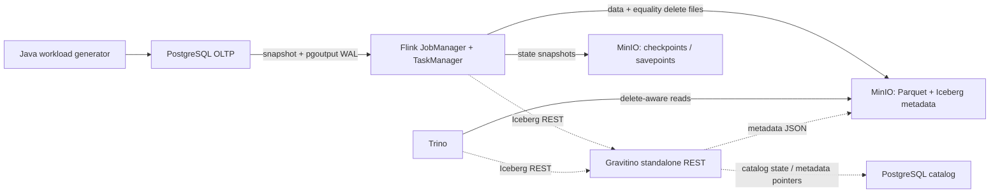

# flink-cdc-lakehouse-lab

**Статус проверки:** образы собраны, unit-тесты и S3/REST/Trino bootstrap проверены. Полный CDC E2E после последнего исправления JVM options ещё не выполнен; подробности в [docs/validation.md](docs/validation.md).

Локальный практикум для Java/backend-разработчика: PostgreSQL snapshot + WAL → Flink Table API changelog → Iceberg v2/Parquet → независимое чтение Trino. Данные синтетические. Это учебная модель платежей, не банковский ledger.



Стрелки к каталогу — путь метаданных. Gravitino не переносит строки OLTP: оба Iceberg-клиента обращаются к `/iceberg`, а файлы хранятся в MinIO. Полный Gravitino Server и metalake рассматриваются отдельно в лабораторной 14.

## Run and debug in VS Code

Open **this repository root** with File → Open Folder, so VS Code sees the parent
`pom.xml` and both Maven modules. Install the workspace recommendations from the
Extensions view (`@recommended`): **Extension Pack for Java** and **Spring Boot
Extension Pack**. Both packs are installed on the machine used for this setup. The Spring pack
adds tooling for separate Spring Boot projects.

The workspace settings select the installed **Amazon Corretto JDK 17** for this
project and new integrated terminals. The JDK path in `.vscode/settings.json` and
`.vscode/tasks.json` is specific to this Mac. On another machine, update it through
**Java: Configure Java Runtime** and update the task/terminal `JAVA_HOME` paths.
Maven Wrapper now honors `JAVA_HOME`. The Java language server can use its bundled
runtime independently of the project's JDK; do not set `java.jdt.ls.java.home` to
JDK 17. See [Java runtime setup](https://github.com/redhat-developer/vscode-java#setting-the-jdk).

`JobConfig` is a Java record, supported by this project's Java 17 release. The POM
now has explicit Java/dependency defaults so IDE Maven import works without shell
exports. When `mvnw` or Docker exports `versions.env`, Maven profiles use those
values instead. When changing `JAVA_RELEASE`, `FLINK_VERSION`, `JDBC_VERSION`, or
`JUNIT_VERSION` in `versions.env`, also update the matching defaults in the root
`pom.xml` so IDE import and wrapper builds stay aligned.

If old syntax errors remain after reopening the folder, run **Java: Clean Java
Language Server Workspace**, allow the restart, and wait for Maven import to finish.
Check **Java: Configure Java Runtime** shows JavaSE-17 for both modules. Use the
Java Projects and Testing views to navigate and run JUnit tests.

- **Run → Run Without Debugging** (`Ctrl+F5`): select **Generator: dry run (no
  database)**. It prints three reproducible sample amounts and exits.
- **F5**: use the same configuration with breakpoints in `WorkloadGenerator` or
  `GeneratorConfig`. `JobConfig` has no `main`; debug `JobConfigTest` from Testing.
- **Terminal → Run Task → Java: test** runs both modules' JUnit tests.
- **Terminal → Run Build Task** packages `pipeline.jar` and `generator.jar` using
  the pinned Maven Wrapper.
- To run the complete CDC pipeline: start Docker, then run **Lab: initialize**,
  **Lab: build containers**, and **Lab: run demo** in order. These use the existing
  lab runner and cluster submission flow. Use **Lab: status** to inspect it and
  **Lab: stop containers** to stop the stack while retaining volumes.

For local JDBC debugging, first initialize, build, and bootstrap the stack
(`make init`, `make build`, `make up`, `make bootstrap`), then use **Generator:
seed local PostgreSQL** before **Generator: finite workload on local PostgreSQL**.
Both configurations load `APP_PASSWORD` from the ignored `.env` and connect via
`127.0.0.1:55432`, the default host port. If `PG_PORT` changes, update `JDBC_URL`
in `.vscode/launch.json`. These modes write synthetic data to the lab database.
The finite workload requires the seeded customer/account rows. To stream those
changes into Iceberg, also submit the Flink job using the existing `make submit`
flow; consult the restore instructions if a job has run before.

The Flink main class runs through the Docker cluster submission flow: it needs
connector/planner/S3 plugins, service DNS, and runtime configuration supplied by
the images. Run it with the lab tasks above. The generator can run directly with
F5 because its Maven runtime classpath includes the PostgreSQL driver.

### Java and Spring Boot environment

This lab uses plain JDBC and Flink and contains no Spring Boot application.
For a separate Spring project, install **Spring Boot Extension Pack**
(`vmware.vscode-boot-dev-pack`), run **Spring Initializr: Create a Maven Project**,
choose a Java version supported by the selected Spring Boot release, and open the
new project in its own VS Code folder. Its Maven `java.version` controls the
project release; configure a matching installed JDK using **Java: Configure Java
Runtime**. Your Mac already has JDK 17, 21, and 23; this workspace stays on 17.

Wait for Maven import, then run the application's `main` method with Run/Debug
or start it from **Spring Boot Dashboard**. Set breakpoints before F5; put local
application configuration in `application.properties` or `application.yml` and
keep secrets out of committed files. The Maven terminal alternative is
`./mvnw spring-boot:run` from the Spring project root. See the official
[Spring Boot in VS Code guide](https://code.visualstudio.com/docs/java/java-spring-boot)
and [Java extension guide](https://code.visualstudio.com/docs/java/extensions).

## Первый запуск

Нужны Docker Desktop/Engine + Compose v2, Python ≥3.9, curl, make. Java 17 нужна для локального `make test-unit`; Docker build сам содержит JDK и Maven Wrapper. Образы разрешены для amd64/arm64; реальную архитектуру и выполненные проверки смотрите в [docs/validation.md](docs/validation.md). Оценка baseline: 4 CPU, 6–8 GiB Docker RAM и 12 GiB свободного диска. Сборка MinIO из source при первом запуске заметно дольше последующих.

```bash
make init                 # первый раз; создаёт .env, повторно обновляет шаблоны
make doctor               # Docker, ресурсы, порты, доступность pinned base images
make build                # первый раз и после изменения исходников
make demo                 # первый полный результат: bootstrap → seed → snapshot → CRUD → exact reconciliation
```

`make demo` завершается после конечной нагрузки и полной сверки ключей/бизнес-полей. Сам streaming job остаётся RUNNING и ожидает новые WAL-события. Обычный restart генератора не повторяет seed: маркер набора хранится в OLTP и фиксируется вместе с 100 customers, 200 accounts, 10 000 payments. Не удаляйте этот маркер вручную.

Наличие запущенных контейнеров ещё не означает готовность данных: сначала завершается snapshot, затем Flink checkpoint и публикация Iceberg snapshot, затем Trino видит строки. Начальный checkpoint interval — 10 секунд. `make reconcile` ждёт точного совпадения с неизменяемым PostgreSQL snapshot, а не только совпадения count.

Если job уже останавливался или JobManager терялся, `make submit` потребует явный restore. Он не запускает скрытый новый snapshot поверх существующего sink. [Runbook восстановления](docs/recovery.md).

## Команды

| Команда | Действие |
|---|---|
| `make init` | Создать локальные credentials; отрендерить конфиги, не предполагая ENV-подстановку сервисами |
| `make build` | Проверить SHA-256 downloads, Maven Wrapper tests/package, multi-stage images |
| `make up` | Базы + MinIO → bucket/user init → REST/Flink/Trino; bounded readiness |
| `make bootstrap` | Роли, schema/publication, buckets, Iceberg namespace/tables; S3 read/write probe |
| `make seed` | Однократный небольшой dataset seed=42 |
| `make submit` | Один job, REST-проверка статуса и сериализация submit файловым lock |
| `make generate RATE=20 DURATION=120` | Ограниченная нагрузка, batches=20; graceful stop закрывает транзакции |
| `make finite` | INSERT/повторные UPDATE/коррекция суммы/DELETE/ROLLBACK, включая multi-table transaction |
| `make query` / `make reconcile` | Аналитика/полная сверка после остановки нагрузки |
| `make status` / `make logs` | Jobs, checkpoints, slots/LSN, логи |
| `make test-unit` | JUnit + unit-проверки независимой сверки |
| `make test-e2e` | Новый изолированный реальный Compose-стенд; сценарии A–L и отчёт |
| `make savepoint` | Savepoint работающего job; путь в `.runtime/savepoint.json` |
| `make stop-with-savepoint` | Planned stop, `drain=false`, дождаться FINISHED |
| `make restore SAVEPOINT=s3://savepoints/...` | Тот же jar/план, `allowNonRestoredState=false` |
| `make down` | Остановить контейнеры; volumes и локальный job state сохраняются |
| `make reset CONFIRM=YES` | Удалить **только ресурсы этого проекта**, включая MinIO/state/catalog и slots |
| `make stress-up` | Явно включить второй TaskManager; оценка ≥12 GiB RAM; нагрузка отдельно |

Перед `test-e2e` остановите baseline: `make stop-with-savepoint`, затем `make down`, чтобы два стенда не конкурировали за RAM. Runner использует отдельное имя проекта, отдельные порты, `.runtime/e2e/<run>/`, сохраняет логи, seed, assertions, job/checkpoint/snapshot IDs и JUnit XML; удаляет лишь собственные тестовые volumes в teardown. Зависимости pytest закреплены в `tests/e2e/requirements.lock`. Интервал checkpoints в тестах — 5 секунд.

## Superset: просмотр данных в браузере

После работающего demo выполните `make superset-up`. Команда собирает официальный
Superset 6.1.0 с PostgreSQL/Trino-драйверами, создаёт отдельную metadata database и
администратора, добавляет подключения и проверяет чтение таблиц. Повторный запуск
сохраняет credentials, dashboards и существующие настройки пользователя; созданные
подключения, datasets и учебные SQL-запросы обновляются без дубликатов.

Откройте **http://127.0.0.1:18088**. Логин и случайный пароль находятся в
`.runtime/superset-login.txt` (доступ только владельцу файла). Credentials и ключ
шифрования сохраняются в игнорируемом `.env`; не меняйте `SUPERSET_SECRET_KEY`
после создания подключений без процедуры ротации Superset.

В **Settings → Database Connections** доступны:

| Подключение | Данные |
|---|---|
| PostgreSQL — source | `payments`, схема `public`: customers, accounts, payments |
| Trino — Iceberg | catalog `iceberg`, схема `oltp_mirror`: customers_current, accounts_current, payments_current |

В **Data → Datasets** зарегистрированы все шесть таблиц. В **SQL → Saved Queries**
есть четыре запроса: последние платежи и группировка по статусу/валюте для каждого
источника. Чтобы выполнить свой SQL, откройте **SQL → SQL Lab**, выберите источник
и его schema, затем, например, выполните:

```sql
SELECT payment_id, amount, currency, status, row_version
FROM oltp_mirror.payments_current
ORDER BY payment_id DESC
LIMIT 100;
```

Для PostgreSQL аналогичная таблица называется `public.payments`. PostgreSQL
подключён отдельной ролью `lab_bi`, имеющей только SELECT на три бизнес-таблицы.
В обоих подключениях Superset отключены DML, CTAS, CVAS и загрузка файлов.
Trino использует существующий лабораторный сервер без отдельного backend ACL;
эти настройки ограничивают запись через интерфейс Superset. Superset не является
прямым клиентом MinIO: Iceberg читает Trino.

`make superset-status` проверяет контейнеры и `/health`; `make superset-down`
останавливает только BI-сервисы. `make down` останавливает весь стенд, сохраняя
volumes. Superset запускается явно через профиль `bi`; обычный demo не требует
его запуска. `make reset CONFIRM=YES` удаляет также metadata Superset и dashboards.
После `make up` запустите `make superset-up`, чтобы вернуть BI-интерфейс.
Дополнительные сервисы требуют примерно 1–2 GiB RAM; веб-порт привязан к localhost.

Официальные инструкции: [Superset Docker](https://superset.apache.org/docs/installation/docker-compose/),
[database drivers](https://superset.apache.org/docs/databases/).

## Локальные адреса

Все опубликованные порты привязаны к **127.0.0.1**. Внутри Docker используются service DNS и внутренние порты.

| Сервис | Host URL / port | В Docker |
|---|---|---|
| PostgreSQL OLTP | 55432 | postgres-oltp:5432 |
| MinIO API | http://127.0.0.1:19000 | minio:9000 |
| MinIO Console | http://127.0.0.1:19001 | minio:9001 |
| Gravitino REST | http://127.0.0.1:19002/iceberg | gravitino-iceberg-rest:9001/iceberg |
| Flink UI | http://127.0.0.1:18081 | flink-jobmanager:8081 |
| Trino | http://127.0.0.1:18080 | trino:8080 |

Каталожная БД не публикуется. Пароли находятся только в игнорируемых `.env` и `.runtime/config/`. Изменение пароля в `.env` не меняет пароль уже созданного PostgreSQL role автоматически. После изменения runtime-настроек: `make init` и planned restart/restore. Не применяйте laboratory S3/admin-права к production.

## Файлы и дальнейшая работа

- `versions.env`, `config/artifacts.lock.json`, [матрица](docs/versions.md), [источники](docs/sources.md).
- `compose.yaml`, `docker/Dockerfile`, `scripts/lab.py` — инфраструктура и проверяемый bootstrap.
- `flink-job/src/main/java/lab/`, `sql/flink/` — Java Table API/SQL; Flink API provided, тонкий pipeline.jar.
- `workload-generator/src/main/java/lab/`, `sql/postgres/` — plain JDBC, Decimal, статусы, версия строки, ручной CRUD.
- `scripts/verify.py`, `tests/e2e/` — независимые psql и Trino read paths, faults и reconciliation.
- [Понятия](docs/concepts.md), [решения](docs/decisions.md), [recovery](docs/recovery.md), [диагностика](docs/troubleshooting.md), [14 лабораторных](labs/README.md).

Реализован baseline и автоматизированные сценарии; выполнение дополнительных упражнений 09, 11–14 остаётся ручной учебной работой. Нет Kafka, Spark, Airflow, Kubernetes, dbt, Spring Boot или BI в обязательном старте. Реальные результаты и незавершённые проверки честно перечислены в [validation.md](docs/validation.md).

Dry-run генератора (без подключения к БД): после экспорта `versions.env` и `.env` выполните `docker compose run --rm --no-deps workload-generator --mode finite --seed 42 --dry-run`. Для полного списка закреплённых JAR и checksum: [docs/artifacts.md](docs/artifacts.md).

[Полный список созданных файлов](docs/files.md).
