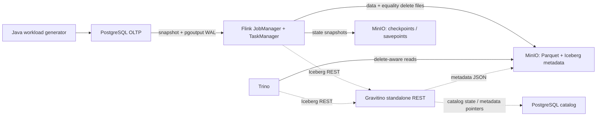

# flink-cdc-lakehouse-lab

A hands-on data engineering lab demonstrating PostgreSQL CDC → Apache Flink → Apache Iceberg, with Trino queries and Superset visualization. Includes a Java workload generator, Docker Compose setup, data reconciliation, checkpoint/savepoint recovery exercises, and VS Code debugging support.



The arrows to the catalog show the metadata path. Gravitino does not transfer OLTP rows: both Iceberg clients access `/iceberg`, while the files are stored in MinIO. The full Gravitino Server and metalake are covered separately in lab 14.

## Run and debug in VS Code

Open **this repository root** with File → Open Folder, so VS Code sees the parent
`pom.xml` and both Maven modules. Install the workspace recommendations from the
Extensions view (`@recommended`): **Extension Pack for Java** and **Spring Boot
Extension Pack**. Both packs are installed on the machine used for this setup. The Spring pack
adds tooling for separate Spring Boot projects.

The workspace settings select the installed **Amazon Corretto JDK 17** for this
project and new integrated terminals. The JDK path in `.vscode/settings.json` and
`.vscode/tasks.json` is specific to this Mac. On another machine, update it through
**Java: Configure Java Runtime** and update the task/terminal `JAVA_HOME` paths.
Maven Wrapper now honors `JAVA_HOME`. The Java language server can use its bundled
runtime independently of the project's JDK; do not set `java.jdt.ls.java.home` to
JDK 17. See [Java runtime setup](https://github.com/redhat-developer/vscode-java#setting-the-jdk).

`JobConfig` is a Java record, supported by this project's Java 17 release. The POM
now has explicit Java/dependency defaults so IDE Maven import works without shell
exports. When `mvnw` or Docker exports `versions.env`, Maven profiles use those
values instead. When changing `JAVA_RELEASE`, `FLINK_VERSION`, `JDBC_VERSION`, or
`JUNIT_VERSION` in `versions.env`, also update the matching defaults in the root
`pom.xml` so IDE import and wrapper builds stay aligned.

If old syntax errors remain after reopening the folder, run **Java: Clean Java
Language Server Workspace**, allow the restart, and wait for Maven import to finish.
Check **Java: Configure Java Runtime** shows JavaSE-17 for both modules. Use the
Java Projects and Testing views to navigate and run JUnit tests.

- **Run → Run Without Debugging** (`Ctrl+F5`): select **Generator: dry run (no
  database)**. It prints three reproducible sample amounts and exits.
- **F5**: use the same configuration with breakpoints in `WorkloadGenerator` or
  `GeneratorConfig`. `JobConfig` has no `main`; debug `JobConfigTest` from Testing.
- **Terminal → Run Task → Java: test** runs both modules' JUnit tests.
- **Terminal → Run Build Task** packages `pipeline.jar` and `generator.jar` using
  the pinned Maven Wrapper.
- To run the complete CDC pipeline: start Docker, then run **Lab: initialize**,
  **Lab: build containers**, and **Lab: run demo** in order. These use the existing
  lab runner and cluster submission flow. Use **Lab: status** to inspect it and
  **Lab: stop containers** to stop the stack while retaining volumes.

For local JDBC debugging, first initialize, build, and bootstrap the stack
(`make init`, `make build`, `make up`, `make bootstrap`), then use **Generator:
seed local PostgreSQL** before **Generator: finite workload on local PostgreSQL**.
Both configurations load `APP_PASSWORD` from the ignored `.env` and connect via
`127.0.0.1:55432`, the default host port. If `PG_PORT` changes, update `JDBC_URL`
in `.vscode/launch.json`. These modes write synthetic data to the lab database.
The finite workload requires the seeded customer/account rows. To stream those
changes into Iceberg, also submit the Flink job using the existing `make submit`
flow; consult the restore instructions if a job has run before.

The Flink main class runs through the Docker cluster submission flow: it needs
connector/planner/S3 plugins, service DNS, and runtime configuration supplied by
the images. Run it with the lab tasks above. The generator can run directly with
F5 because its Maven runtime classpath includes the PostgreSQL driver.

### Java and Spring Boot environment

This lab uses plain JDBC and Flink and contains no Spring Boot application.
For a separate Spring project, install **Spring Boot Extension Pack**
(`vmware.vscode-boot-dev-pack`), run **Spring Initializr: Create a Maven Project**,
choose a Java version supported by the selected Spring Boot release, and open the
new project in its own VS Code folder. Its Maven `java.version` controls the
project release; configure a matching installed JDK using **Java: Configure Java
Runtime**. Your Mac already has JDK 17, 21, and 23; this workspace stays on 17.

Wait for Maven import, then run the application's `main` method with Run/Debug
or start it from **Spring Boot Dashboard**. Set breakpoints before F5; put local
application configuration in `application.properties` or `application.yml` and
keep secrets out of committed files. The Maven terminal alternative is
`./mvnw spring-boot:run` from the Spring project root. See the official
[Spring Boot in VS Code guide](https://code.visualstudio.com/docs/java/java-spring-boot)
and [Java extension guide](https://code.visualstudio.com/docs/java/extensions).

## First run

You need Docker Desktop/Engine with Compose v2, Python ≥3.9, curl, and make. Java 17 is required for local `make test-unit` runs; the Docker build includes its own JDK and Maven Wrapper. Images are available for amd64/arm64; see [docs/validation.md](docs/validation.md) for the architecture actually used and the checks performed. Estimated baseline resources: 4 CPUs, 6–8 GiB of Docker RAM, and 12 GiB of free disk space. Building MinIO from source makes the first build noticeably slower than subsequent builds.

```bash
make init                 # first run: create .env; subsequent runs refresh configuration templates
make doctor               # check Docker, resources, ports, and pinned base image availability
make build                # first run and after source code changes
make demo                 # first complete result: bootstrap → seed → snapshot → CRUD → exact reconciliation
```

`make demo` finishes after a finite workload and a complete comparison of keys and business fields. The streaming job remains RUNNING, waiting for new WAL events. Restarting the generator does not repeat the seed: a dataset marker is stored in OLTP and committed together with 100 customers, 200 accounts, and 10,000 payments. Do not delete this marker manually.

Running containers do not necessarily mean the data is ready: the initial snapshot must finish, followed by a Flink checkpoint and publication of an Iceberg snapshot, before Trino can see the rows. The initial checkpoint interval is 10 seconds. `make reconcile` waits for an exact match against a fixed PostgreSQL snapshot, rather than comparing row counts alone.

If the job has already been stopped or the JobManager has been lost, `make submit` requires an explicit restore. It does not silently start a new initial snapshot against an existing sink. See the [recovery runbook](docs/recovery.md).

## Commands

| Command | Action |
|---|---|
| `make init` | Create local credentials and render configurations explicitly, without relying on services to substitute environment variables |
| `make build` | Verify download SHA-256 checksums, run Maven Wrapper tests/package, and build multi-stage images |
| `make up` | Start databases + MinIO → initialize buckets/users → start REST/Flink/Trino; enforce readiness timeouts |
| `make bootstrap` | Set up roles, schema/publication, buckets, and Iceberg namespace/tables; test S3 reads and writes |
| `make seed` | Create a small dataset once, using seed=42 |
| `make submit` | Submit one job, check its status through REST, and serialize submissions using a file lock |
| `make generate RATE=20 DURATION=120` | Run a bounded workload with batches=20; close transactions on graceful shutdown |
| `make finite` | Exercise INSERT/repeated UPDATE/amount correction/DELETE/ROLLBACK, including a transaction spanning multiple tables |
| `make query` / `make reconcile` | Run analytics/full reconciliation after stopping the workload |
| `make status` / `make logs` | Inspect jobs, checkpoints, replication slots/LSNs, and logs |
| `make test-unit` | Run JUnit tests and unit tests for independent reconciliation |
| `make test-e2e` | Start a fresh, isolated Compose stack; run scenarios A–L and produce a report |
| `make savepoint` | Create a savepoint for the running job; record its path in `.runtime/savepoint.json` |
| `make stop-with-savepoint` | Perform a planned stop with `drain=false` and wait for FINISHED |
| `make restore SAVEPOINT=s3://savepoints/...` | Restore the same JAR/query plan with `allowNonRestoredState=false` |
| `make down` | Stop containers while preserving volumes and local job state |
| `make reset CONFIRM=YES` | Delete **only this project's resources**, including MinIO/state/catalog data and replication slots |
| `make stress-up` | Explicitly enable a second TaskManager; estimated RAM requirement ≥12 GiB; start the workload separately |

Before `test-e2e`, stop the baseline stack: run `make stop-with-savepoint`, then `make down`, so the two stacks do not compete for RAM. The runner uses a separate project name, separate ports, and `.runtime/e2e/<run>/`. It records logs, seed, assertions, job/checkpoint/snapshot IDs, and JUnit XML, and removes only its own test volumes during teardown. Pytest dependencies are pinned in `tests/e2e/requirements.lock`. The checkpoint interval in tests is 5 seconds.

## Superset: view data in your browser

After running the demo successfully, run `make superset-up`. This command builds the official Superset 6.1.0 image with PostgreSQL/Trino drivers, creates a separate metadata database and administrator account, adds connections, and verifies table reads. Subsequent runs preserve credentials, dashboards, and existing user settings; the lab connections, datasets, and SQL queries are updated without creating duplicates.

Open **http://127.0.0.1:18088**. The username and randomly generated password are stored in `.runtime/superset-login.txt`, which is accessible only to the file owner. Credentials and the encryption key are stored in the ignored `.env`; after creating connections, change `SUPERSET_SECRET_KEY` only through Superset's key rotation procedure.

The following connections are available under **Settings → Database Connections**:

| Connection | Data |
|---|---|
| PostgreSQL — source | Database `payments`, schema `public`: customers, accounts, payments |
| Trino — Iceberg | Catalog `iceberg`, schema `oltp_mirror`: customers_current, accounts_current, payments_current |

All six tables are registered under **Data → Datasets**. **SQL → Saved Queries** contains four queries: latest payments and payments grouped by status/currency for each source. To run your own SQL, open **SQL → SQL Lab**, select a source and its schema, and execute a query such as:

```sql
SELECT payment_id, amount, currency, status, row_version
FROM oltp_mirror.payments_current
ORDER BY payment_id DESC
LIMIT 100;
```

The corresponding PostgreSQL table is `public.payments`. PostgreSQL uses a dedicated `lab_bi` role with SELECT privileges on the three business tables only. DML, CTAS, CVAS, and file uploads are disabled in both Superset connections. Trino uses the existing lab server without a separate backend ACL; these settings restrict writes through the Superset interface. Superset queries Iceberg through Trino rather than accessing MinIO directly.

`make superset-status` checks the containers and `/health`; `make superset-down` stops only the BI services. `make down` stops the entire stack while preserving volumes. Superset is started explicitly through the `bi` profile; the regular demo does not require it. `make reset CONFIRM=YES` also deletes Superset metadata and dashboards. After `make up`, run `make superset-up` to bring the BI interface back. The additional services require approximately 1–2 GiB of RAM; the web port is bound to localhost.

Official instructions: [Superset Docker](https://superset.apache.org/docs/installation/docker-compose/), [database drivers](https://superset.apache.org/docs/databases/).

## Local addresses

All published ports are bound to **127.0.0.1**. Services inside Docker use service DNS names and internal ports.

| Service | Host URL / port | Inside Docker |
|---|---|---|
| PostgreSQL OLTP | 55432 | postgres-oltp:5432 |
| MinIO API | http://127.0.0.1:19000 | minio:9000 |
| MinIO Console | http://127.0.0.1:19001 | minio:9001 |
| Gravitino REST | http://127.0.0.1:19002/iceberg | gravitino-iceberg-rest:9001/iceberg |
| Flink UI | http://127.0.0.1:18081 | flink-jobmanager:8081 |
| Trino | http://127.0.0.1:18080 | trino:8080 |

The catalog database has no published host port. Passwords are kept in the ignored `.env` and `.runtime/config/` files. Changing a password in `.env` does not automatically change the password of an existing PostgreSQL role. After changing runtime settings, run `make init` and perform a planned restart/restore. Do not use the lab's S3/admin permissions in production.

## Files and further work

- `versions.env`, `config/artifacts.lock.json`, [version matrix](docs/versions.md), and [sources](docs/sources.md).
- `compose.yaml`, `docker/Dockerfile`, `scripts/lab.py` — infrastructure and verifiable bootstrap.
- `flink-job/src/main/java/lab/`, `sql/flink/` — Java Table API/SQL; Flink API dependencies use provided scope, producing a thin pipeline.jar.
- `workload-generator/src/main/java/lab/`, `sql/postgres/` — plain JDBC, decimal arithmetic, statuses, row versions, and manual CRUD.
- `scripts/verify.py`, `tests/e2e/` — independent psql and Trino read paths, fault scenarios, and reconciliation.
- [Concepts](docs/concepts.md), [design decisions](docs/decisions.md), [recovery](docs/recovery.md), [troubleshooting](docs/troubleshooting.md), and [14 labs](labs/README.md).

The baseline and automated scenarios are implemented; additional exercises 09 and 11–14 remain manual learning assignments. Kafka, Spark, Airflow, Kubernetes, dbt, Spring Boot, and BI are not required for the initial setup. Actual results and outstanding checks are listed in [validation.md](docs/validation.md).

Generator dry run (without a database connection): after exporting `versions.env` and `.env`, run `docker compose run --rm --no-deps workload-generator --mode finite --seed 42 --dry-run`. See [docs/artifacts.md](docs/artifacts.md) for the complete list of pinned JARs and checksums.

[Complete list of project files](docs/files.md).
