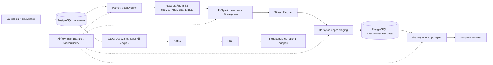

**Data Engineer Sim — исследование и предложение по реализации**

Дата исследования: 24 сентября 2026 года. Это проектное предложение, без реализации и без проведённых нагрузочных испытаний. Документ опирается на официальную документацию, репозитории авторов и опубликованные инженерные кейсы. Размеры учебных наборов, состав заданий и этапы разработки ниже — мои рекомендации, а не характеристики готового продукта.

**1. Рекомендуемая концепция**

Создать симулятор работы data engineer в вымышленном банке: студент получает источник данных, запросы от аналитиков и продуктовых команд, инциденты и критерии приёмки. В собственной IDE он последовательно создаёт работающий репозиторий с загрузкой данных, обработкой, витринами, оркестрацией и потоковыми задачами.

Основная ценность продукта — связанная история, воспроизводимая среда и проверка поведения пайплайна. Одних текстовых инструкций по установке инструментов недостаточно: результат должен сохранять корректность при повторах, обновлениях источника и сбоях.

Предлагаемый путь:

SQL + Python → файлы Parquet и объектное хранилище → PySpark + dbt → Airflow → одно настоящее облако → Kafka → Flink.

Знакомство с объектным хранилищем следует перенести перед Spark; полноценные IAM, облачные вычисления и управление расходами оставить отдельным поздним модулем. Spark и dbt выполняют разные роли: Spark обрабатывает данные, dbt описывает и запускает преобразования на выбранном SQL-движке, организует модели и проверки. S3 хранит объекты; для SQL поверх файлов нужен вычислительный движок. Airflow управляет выполнением задач и не должен служить транспортом для самих наборов данных.

**2. Что уже существует и что полезно перенять**

| Пример | Подтверждённая особенность | Что использовать в проектировании |
| --- | --- | --- |
| [Data Engineering Zoomcamp](https://github.com/DataTalksClub/data-engineering-zoomcamp) | Открытая программа с пакетной обработкой, аналитическим моделированием, потоками и итоговым проектом | Последовательные модули, репозиторий ученика, большой итоговый проект |
| [Jaffle Shop от dbt Labs](https://github.com/dbt-labs/jaffle-shop) | Учебный проект вокруг вымышленного бизнеса | Общий предметный контекст и понятные аналитические модели; выбранный релиз проверять отдельно |
| [Start Data Engineering](https://www.startdataengineering.com/courses/data-engineering-design-patterns-course/) | Обучение проектированию пайплайнов через практические проекты, включая крупные данные | Требования, инженерные решения и объяснение результата |
| [Официальный пример Flink с антифродом](https://nightlies.apache.org/flink/flink-docs-release-1.17/docs/try-flink/datastream/) | Учебный детектор последовательности транзакций с состоянием по счёту | Логику состояния и таймеров; это старый пример, его код нельзя выдавать за актуальный starter |

Это ориентиры по формату, а не исчерпывающий анализ конкурентов. Из этих материалов нельзя заключить, что аналогичной платформы на рынке нет. Гипотезу отличия вашего продукта я бы сформулировал так: единая банковская среда, ежедневное развитие данных, работа в своей IDE и проверяемые инженерные инциденты на всём пути обучения. Её стоит проверить на интервью и пилотном потоке.

**3. Объём данных и учебное назначение Spark**

При 25 000 новых транзакций за сутки получается:

| Период | Новые транзакции |
| --- | ---: |
| 30 дней | 750 000 |
| 90 дней | 2 250 000 |
| 365 дней | 9 125 000 |

Если новых клиентов равномерно выбирать от 20 до 100 в день, математическое ожидание — 60 в день. Через год будет в среднем 24 900 клиентов вместе с первоначальными 3 000; крайние границы при постоянном минимуме/максимуме — 10 300 и 39 500. Средняя интенсивность транзакций — около 0,29 события в секунду. При неизменных 25 000 транзакций и растущем числе клиентов активность на клиента снижается: это нужно сделать явным правилом симуляции.

Количество строк само по себе не доказывает необходимость распределённой обработки. Для данного базового объёма я бы сначала проверял PostgreSQL или однопроцессный аналитический движок. При условных 0,5–2 КБ на транзакцию годовая полезная нагрузка составляет примерно 4,6–18,3 ГБ до учёта индексов, служебных данных, других таблиц и сжатия. Это расчёт по допущению, не измерение.

Нужны три профиля данных:

| Профиль | Предлагаемые параметры | Назначение |
| --- | --- | --- |
| Базовый | 3 000 клиентов, 30–90 дней истории, +25 000 транзакций и +20–100 клиентов в сутки | Основной учебный путь |
| Ускоренный | Те же бизнес-события за управляемые виртуальные дни | Backfill, повторное выполнение, late data, streaming |
| Нагрузочный | Отдельные наборы, например 10/50/200 ГБ, с измеренным фактическим размером | Shuffle, skew, крупные joins, spill, стоимость вычислений |

Нагрузочный набор следует генерировать напрямую в файлы, а не сначала вставлять сотни миллионов строк в OLTP. Масштабировать нужно также клиентов, устройства и мерчантов, сохраняя осмысленную кардинальность и зависимости. Одно копирование одинаковых строк создаёт нерепрезентативную нагрузку.

Не обещать преимущество Spark на заданном количестве строк. Сравнивать одинаковую логику, вход, ресурсы и результат, отдельно измеряя запуск движка и выполнение. В отчёте ученика учитывать план, shuffle, spill, перекос задач, объём чтения и стоимость. Официальная документация описывает настройку партиций, стратегии join и AQE; это подходящие темы лабораторных. [Spark SQL performance tuning](https://spark.apache.org/docs/latest/sql-performance-tuning.html).

**4. Модель банковских данных**

На старте достаточно следующих сущностей:

| Таблица | Содержание | Учебная роль |
| --- | --- | --- |
| `customers` | Профиль клиента, регистрация, сегмент, статус, время изменения | SQL, качество, история атрибутов |
| `accounts` | Клиент, валюта, тип и статус счёта | Связи, ограничения, агрегаты |
| `cards` | Синтетический токен карты, счёт, статус | Привязка событий, блокировка |
| `merchants` | Категория, страна, канал | Обогащение транзакций |
| `transactions` | ID, счёт, мерчант, сумма, валюта, тип, статус, timestamps | Главная таблица фактов |
| `transaction_events` | История изменений статуса с ID и версией события | CDC, повторная доставка, event time |
| `fx_rates` | Валютная пара, дата, курс | Датированные joins и контроль сумм |

Следом добавить `device_events`, `settlement_records` и `fraud_labels`. Первые нужны для антифрода и поведения клиента, вторые — для сверки с внешним платёжным провайдером, третьи — для ML с отложенным подтверждением исхода.

Для MVP лучше выбрать конкретный бизнес-процесс — например, карточные покупки и возвраты. Понятие «банковская транзакция» иначе становится слишком широким. Балансы и бухгалтерские проводки вынести в отдельный продвинутый сценарий: для проверки финансовых инвариантов там уже нужен согласованный журнал проводок, а не случайно сгенерированное поле balance.

Предлагаемый контракт:

- 25 000 — число новых бизнес-транзакций за виртуальные сутки; обновления статусов, строки справочников и технические события считаются отдельно.
- Денежные суммы — `NUMERIC/DECIMAL` либо целые минимальные денежные единицы с явно заданной валютой и её точностью.
- `event_time` обозначает момент события, `source_updated_at` — изменение источника, `ingested_at` — получение конкретным слоем. Хранить timestamps в UTC; бизнес-день задавать явно.
- У каждой транзакции стабильный ID; у события — свой ID, версия и ссылка на транзакцию. Повтор сообщения не становится новой транзакцией.
- Статусы имеют определённые переходы. Отказанная авторизация не входит в проведённый оборот; возврат связывается с исходной покупкой.
- Для расчётов по нескольким валютам заранее задавать дату и правило конвертации. Не суммировать разные валюты напрямую.
- Историческая покупка не может предшествовать регистрации клиента или открытию счёта.

Синтетические профили должны иметь устойчивое поведение: активные и неактивные клиенты, зарплатные дни, привычные страны и устройства, распределение сумм с редкими большими значениями. Конкретные распределения — настройки учебного мира, а не утверждение о реальном банковском рынке.

**5. Генератор: ежедневная жизнь и воспроизводимость**

Один программный движок должен поддерживать начальный seed, генерацию суток, диапазон дат, воспроизведение событий и добавление учебного инцидента. Для малых объёмов подходят Python, Faker для профильных полей и собственная доменная логика. Для нагрузки — параллельная генерация через Spark; [dbldatagen](https://github.com/databrickslabs/dbldatagen) можно оценить как готовую основу, но бизнес-правила банка всё равно придётся описать.

Запуск определяется `dataset_version`, `generator_version`, seed, номером виртуального дня и сценарием. Желательно выводить случайные значения из стабильного ключа сущности: изменение порядка обработки не должно менять весь набор. Одного seed недостаточно при изменении библиотек: Faker прямо связывает воспроизводимость с версией и последовательностью вызовов. [Документация Faker](https://faker.readthedocs.io/en/latest/).

В таблице запусков хранить диапазон, статус, контрольные количества и идентификатор версии. Повтор генерации даты не добавляет ещё 25 000 транзакций. Уникальный ключ запуска и блокировка исключают одновременную генерацию одних суток; фиксация результата и отметки завершения должна переживать остановку процесса. Для межсистемной публикации нужны промежуточные статусы и повторяемое завершение, а не предположение об общей транзакции PostgreSQL и S3.

Центральный экземпляр симулятора запускать по UTC-расписанию на сервере платформы, например ежедневно после окончания суток, с догенерацией пропущенных дней. Генератор источника принадлежит платформе и работает независимо от учебного Airflow. На ноутбуке пользователя ежедневный процесс работает только при доступной машине; после возвращения полезно автоматически предложить догнать виртуальные дни.

Совместить два режима:

- **Живая база:** продолжает расти каждый день; подходит для эксплуатации уже построенного пайплайна.
- **Учебная копия:** фиксированный снимок со своей виртуальной датой; подходит для задания и проверки. Ученик может перейти на следующий день, восстановить checkpoint или повторить инцидент.

Нельзя выдавать одно mutable-состояние всем студентам с правом записи. Общие опубликованные снимки можно раздавать для чтения, рабочие базы и результаты должны быть отдельными. Снапшот включает согласованные справочники, а не только файл транзакций.

Учебные поломки: повтор файла, поздняя транзакция, устаревшая версия события, появление nullable-поля, неверный тип суммы, обновление категории мерчанта, отказ загрузки после частичной записи. Некорректные строки, противоречащие ограничениям OLTP, удобнее вводить в файл внешнего источника или landing-слой. Не следует ради урока ломать базовые ограничения банковской базы.

**6. Архитектура учебного пайплайна**

Эта схема — рекомендуемая начальная интеграция. До изучения Spark Python готовит небольшой staging-набор напрямую; затем Spark заменяет соответствующую обработку. Так предыдущая работа развивается, а не выбрасывается.

Связь Spark → dbt должна быть объяснена в заданиях. В базовом профиле Spark пишет очищенные Parquet, отдельная загрузка переносит необходимые данные в staging аналитической PostgreSQL, затем dbt с `dbt-postgres` строит модели. Загрузку делать через run-specific staging и контролируемый upsert/замену затронутых разделов, чтобы retry не удваивал данные. Источник и аналитическую базу разграничить правами; для ноутбука допустим один сервер PostgreSQL с разными базами. [Подключение PostgreSQL к dbt](https://docs.getdbt.com/docs/local/connect-data-platform/postgres-setup).

В нагрузочном профиле не нужно перегружать все крупные таблицы обратно в PostgreSQL. Продвинутый вариант — Iceberg, общий каталог и Spark SQL; для dbt поверх Spark потребуется совместимый adapter и способ подключения, например Thrift Server. Проверку совместимости этого пути выделить в отдельный технический прототип. Актуальная документация dbt разделяет поколения движка и ограничения адаптеров, поэтому «поставить latest всего» — плохой контракт курса. [Spark adapter](https://docs.getdbt.com/docs/local/connect-data-platform/spark-setup), [Iceberg + Spark](https://iceberg.apache.org/docs/latest/spark-getting-started/).

Parquet — формат файлов; Iceberg — табличный слой с метаданными. Их нельзя считать взаимозаменяемыми словами. Для старта Parquet достаточно, операции над изменяющимися lakehouse-таблицами добавить после освоения инкрементов. Выбрать один табличный формат для основной программы; второй оставить сравнительным материалом.

Для локального объектного хранилища я бы проверил SeaweedFS. В текущем репозитории есть запуск S3-совместимого сервиса, в том числе через Docker. Совместимость со Spark S3A и нужными операциями должна пройти отдельный smoke test. MinIO Community нельзя автоматически переносить из старых туториалов: его репозиторий архивирован 25 апреля 2026 года и помечен как неподдерживаемый. Это замечание относится именно к community-репозиторию, а не ко всем продуктам компании. [SeaweedFS](https://github.com/seaweedfs/seaweedfs), [статус MinIO](https://github.com/minio/minio).

**7. Учебная программа**

Предлагаемый полный путь — около 35–45 небольших заданий и один итоговый проект. Количество нужно уточнить после пилота; не каждый пункт таблицы должен становиться отдельной большой лабораторной.

| Этап | Задания и навыки | Проверяемый результат |
| --- | --- | --- |
| Подготовка | Git, терминал, переменные окружения, Docker, подключения, чтение схемы | Студент запускает окружение, понимает источник и может воспроизвести snapshot |
| SQL | Joins, оконные функции, дедупликация, оборот по дням, клиентские когорты, планы и индексы | Правильные суммы, кардинальность, объяснение плана |
| Python / ingestion | Чтение порциями, файлы, Parquet, явная схема, логирование, инкремент, checkpoint, retries | Повтор запуска безопасен, сбой не теряет данные |
| Spark / PySpark | DataFrame, Spark SQL, joins, окна, партиции, skew, Spark UI, перерасчёт | Тот же бизнес-результат на расширенном наборе; измеренный план |
| dbt | Sources, staging/intermediate/marts, `ref`, tests, документация, инкрементальные модели, история клиентов | Согласованные витрины с тестами и lineage |
| Airflow | DAG, интервалы данных, зависимости, retry, backfill, контроль качества, уведомление об ошибке | Несколько виртуальных дней проходят автоматически, один день можно безопасно пересчитать |
| Cloud | Bucket, IAM, секреты, запуск Spark-job, инфраструктура как код, стоимость, удаление ресурсов | Пайплайн выполняется в одном облаке и повторно разворачивается |
| Kafka | Topics, ключи, partitions, offsets, consumer groups, replay, schema version | События воспроизводятся, понятны порядок и границы гарантий |
| Flink | Flink SQL, event time, watermarks, окна, состояние, checkpoints; далее PyFlink | Корректные метрики и алерты при опозданиях и рестарте |
| Итоговый проект | Backfill + ежедневная загрузка + поток + инцидент + runbook | Воспроизводимый работающий продукт данных и объяснение компромиссов |

Качество данных, Git, тестирование и наблюдаемость должны сопровождать весь путь. В начале достаточно SQL-проверок и pytest, далее добавить встроенные data tests dbt: уникальность, заполненность, допустимые значения и связи. Не требуется сразу вводить несколько конкурирующих фреймворков качества. [dbt data tests](https://docs.getdbt.com/docs/build/data-tests).

Для инкрементов полезно разобрать различие новых и изменённых строк. Курсор только по `created_at` пропускает обновления; составной курсор по времени изменения и ID помогает при одинаковых timestamps, но требует аккуратной обработки конкурентных транзакций. В учебном batch-профиле можно фиксировать верхнюю границу выгрузки, использовать перекрывающееся окно и upsert. Удаления и полная история промежуточных изменений — повод перейти к CDC. [Debezium PostgreSQL connector](https://debezium.io/documentation/reference/stable/connectors/postgresql.html).

С Airflow учить повторяемым задачам, обработке конкретного интервала и передаче ссылок на объекты вместо DataFrame через XCom. Это соответствует рекомендациям самого проекта. [Airflow best practices](https://airflow.apache.org/docs/apache-airflow/stable/best-practices.html).

**8. Как выглядит одно задание**

Пример: «После повторной загрузки файла оборот банка удвоился».

Бизнес-запрос: подготовить дневную витрину проведённых покупок с отдельным учётом возвратов. Даны фиксированные исходные события, обновления статусов и манифест файлов. Заранее определены бизнес-день, валюта расчёта и поведение поздних данных.

Ученик должен реализовать загрузку и модель `mart_daily_turnover`, затем обработать три дня, повторно получить файл второго дня, принять запоздалую покупку первого дня и исправление статуса.

Критерии приёмки:

1. При обычной загрузке суммы и количество бизнес-транзакций совпадают с эталоном.
2. Повтор файла не меняет итог.
3. Поздняя покупка корректирует положенный день, а не день доставки.
4. Старая версия статуса не перезаписывает новую.
5. После остановки между staging и публикацией повторный запуск восстанавливает правильный результат.
6. В логе видны dataset, интервал, run ID и контрольные количества.

Карточка задания содержит: контекст, цель, prerequisites, входной контракт, формат результата, ограничения, критерии, несколько уровней подсказок и разбор после решения. Инструкции сначала объясняют операции и проверки, а конкретную реализацию оставляют студенту. Сложные задания можно выдавать в формате рабочего тикета с менее подробным сопровождением.

**9. Какие сценарии Spark включить**

Главный приоритет — использовать банковский мир повторно. Отраслевые расширения имеют смысл после устойчивого основного трека.

| Сценарий | Предлагаемая лабораторная | Что изучается | Приоритет |
| --- | --- | --- | --- |
| Банковская аналитика | Суточные обороты, активность, категории расходов и валютная нормализация | DataFrame, SQL, joins, агрегации | Основной путь |
| Сверка с процессингом | Сопоставить транзакции и settlement-отчёт; найти пропуски, дубли и расхождения | Full outer/anti joins, дедупликация, перекос ключей | Основной путь и сильный нагрузочный кейс |
| Customer 360 | Собрать профиль клиента и признаки за 7/30/90 дней | Окна, исторические атрибуты, инкременты | Основной путь |
| Антифрод | Частые операции, новое устройство, необычная география | Structured Streaming, event time, state, enrichment | Продвинутый путь |
| ML-подготовка | Фичи на момент операции и появляющиеся позже fraud labels | Point-in-time joins, отсутствие утечки будущего, временной split | Дополнительный трек |
| Эксплуатация lakehouse | Пересчитать историю после смены правила, уплотнить мелкие файлы | Backfill, файловый layout, публикация результатов | Продвинутый путь |

Подтверждённые примеры:

- Amazon описывает финансовую сверку на EMR и PySpark, включая файлы более 100 ГБ и до 100 млн транзакций. Это пример производственной задачи, близкой вашей тематике. Опубликованную производительность нельзя переносить на ноутбук или будущую платформу. [Инженерный кейс Amazon](https://aws.amazon.com/blogs/big-data/how-amazon-optimized-its-high-volume-financial-reconciliation-process-with-amazon-emr-for-higher-scalability-and-performance/).
- Databricks публикует демонстрацию банковской платформы и обнаружения мошенничества. Это референсный demo, а не независимое доказательство эффективности продукта в банке. [FSI fraud demo](https://notebooks.databricks.com/demos/lakehouse-fsi-fraud/00-FSI-fraud-detection-introduction-lakehouse.html).
- Uber описывает применение Spark MLlib и распределённого XGBoost к большим наборам, в том числе для ETA. Это поддерживает включение подготовки признаков и больших обучающих наборов; не означает, что каждый online-запрос прогноза нужно выполнять Spark-job. [Uber Engineering](https://www.uber.com/jp/en/blog/productionizing-distributed-xgboost/).

Приведённую пользователем отраслевую таблицу я бы превратил в расширения:

| Отрасль | Адаптация к банковской платформе | Решение |
| --- | --- | --- |
| Ритейл | Аналитика мерчантов и расходов по категориям | Добавить; чековые позиции, скидки и остатки потребуют отдельного источника |
| Финтех / антифрод | Транзакции, устройства, временные окна и алерты | Основной advanced-сценарий |
| Промышленность / IoT | Телеметрия банкоматов и журнал обслуживания | Позднее расширение; из одних транзакций не следует прогноз поломок |
| Маркетинг / продукт | Сегментация по тратам; позже события мобильного банка | Сегментацию добавить рано, clickstream отдельно |
| Логистика | Доставка карт: заказы, статусы и GPS | Отдельный пакет данных после MVP |
| DS / ML | Исторические признаки и delayed labels | Дополнительный трек с акцентом на подготовку данных |

Для ритейла есть опубликованный доклад Burger King о рекомендациях с Spark и MLlib; для IoT — демонстрация обслуживания ветротурбин Databricks. Они подтверждают применимость направлений, но не необходимость встраивать их все в первую версию. [Программа с кейсом Burger King](https://www.databricks.com/wp-content/uploads/2021/05/Retail_Industry_Guide_to_DAIS21.pdf), [IoT demo](https://notebooks.databricks.com/demos/lakehouse-iot-platform/00-IOT-wind-turbine-introduction-DI-platform.html).

**10. Как связать Kafka, Spark Streaming и Flink**

Kafka хранит и передаёт события; Spark Structured Streaming и Flink могут решать пересекающиеся задачи обработки. Их не нужно последовательно ставить в одну обязательную цепь.

Предлагаемый порядок: сначала Kafka producer/consumer и replay; затем небольшая сравнительная лабораторная с Structured Streaming на знакомом PySpark; затем основная потоковая специализация на Flink. Обрабатывать одинаковый сценарий двумя движками полезно для сравнения, но не нужно постоянно держать оба решения активными.

Для базовой лабораторной producer воспроизводит тот же журнал событий, что используется batch-пайплайном. Более реалистичная следующая ступень — PostgreSQL → Debezium → Kafka. Если нужны именно доменные события, запись в outbox в одной транзакции с изменением бизнес-данных помогает избежать несогласованного dual write. Простой независимый INSERT в БД и send в Kafka не даёт такой согласованности. [Debezium outbox](https://debezium.io/documentation/reference/transformations/outbox-event-router.html).

25 000 событий в день недостаточно для показательной потоковой нагрузки, поэтому нужен replay с заданной скоростью, например 100 или 1 000 событий/сек как параметры эксперимента. Это не обещание пропускной способности. Сохранять относительные времена и причинность, отдельно контролировать опоздания и порядок доставки; для водяных знаков проверять продвижение всех входных партиций, включая простаивающие.

Задания Flink: оконные метрики, keyed state, политика поздних событий, восстановление после checkpoint и отсутствие повторного бизнес-алерта после рестарта. Сначала достаточно Flink SQL, затем PyFlink; Java/CEP можно оставить углублённым направлением. [Event time во Flink](https://nightlies.apache.org/flink/flink-docs-stable/docs/concepts/time/), [checkpointing](https://nightlies.apache.org/flink/flink-docs-stable/docs/dev/datastream/fault-tolerance/checkpointing/).

Базовый режим Structured Streaming в курсе — микропакеты. Гарантию exactly-once нужно разбирать для всего пути source → state → sink: наличие checkpoints само по себе не исключает повтор внешнего эффекта. В частности, Spark `foreachBatch` по умолчанию даёт at-least-once запись. Для алертов пригодится стабильный ключ и идемпотентный upsert; для транзакционных sinks — отдельная проверка соответствующих настроек. [Spark Structured Streaming](https://spark.apache.org/docs/latest/streaming/apis-on-dataframes-and-datasets.html), [Kafka delivery semantics](https://kafka.apache.org/41/design/design/).

Отдельный промышленный пример именно Flink — N26 и обнаружение мошенничества с малой задержкой. Он полезен для обсуждения выбора движка, но заявленные в кейсе 500 мс не являются SLA симулятора. [Кейс N26](https://aws.amazon.com/solutions/case-studies/n26-case-study/).

**11. Платформа и проверка заданий**

Предлагаемая собственная часть продукта: веб-приложение с программой и прогрессом, API, библиотека заданий, CLI для локальной IDE, сервис симуляции и отдельные workers проверки. Для реализации я бы выбрал React/Next.js, Python/FastAPI и PostgreSQL для метаданных; конкретный frontend-фреймворк здесь не определяет учебную ценность. Начать можно с единого backend-приложения и отделить выполнение ученического кода процессно и инфраструктурно.

Сохранять в метаданных версии задания, набора данных и rubric; попытку привязывать также к commit SHA и digest среды. Задания хранить как Markdown + декларативный манифест + fixtures и тесты. Это позволяет редактировать программу через Git и проверять её в CI. Рабочие данные банка, аналитические результаты и служебную БД платформы держать раздельно.

Веб-интерфейсу нужны карта пути, страница задания, словарь данных, подсказки, результаты проверок и история попыток. Встроенную IDE для первого выпуска не считаю необходимой: пользователь явно хочет работать у себя.

Уровни проверки:

| Уровень | Механика | Ограничение |
| --- | --- | --- |
| Локальная самопроверка | CLI запускает открытые тесты и показывает diff | Полезна для обучения, отчёту с чужой машины нельзя доверять как подтверждению экзамена |
| Проверка результата | Сервер принимает артефакты для конкретного dataset и сверяет схему, значения и инварианты | Правильный артефакт не доказывает применение Spark или правильную архитектуру |
| Независимый запуск | Изолированный worker исполняет submission на закрытых сценариях | Дороже, требует лимитов ресурсов и инфраструктурной изоляции |
| Инженерный разбор | Анализ плана, журналов и объяснений решения | Нужен для навыков, которые не сводятся к совпадению таблицы |

Для самостоятельного обучения начать с первого уровня и прозрачно обозначить доверие к результату. Перед формальным подтверждением навыка добавить независимый запуск. Нельзя считать «секретными» тесты, которые уже установлены на компьютер ученика.

Проверять схему, nullable, денежную точность, бизнес-ключи, количества, суммы по валютам, пропуски и лишние строки; затем идемпотентность, late data, обновления и восстановление. Для распределённого результата не требовать случайного порядка строк. Численные допуски допустимы для approximate-метрик, но не должны скрывать ошибки денежных расчётов. Производительность проверять только на контролируемой среде и отдельно от корректности.

Исполнение присланного Python/SQL/контейнера — самостоятельный компонент. Предлагаемые ограничения: одноразовая VM или сопоставимая изоляция, отдельные credentials, CPU/RAM/time/disk quotas, контролируемый исходящий доступ и гарантированная очистка. Не запускать чужой код в API-процессе и не предоставлять ему Docker socket хоста. Это часть архитектуры проверки, а не задача ученика в первом модуле.

**12. Starter и требования к среде**

Выдать два режима: минимальная основа с инфраструктурой, контрактами и TODO; более подробная основа с интерфейсами функций и примерами подключений. Эталонное решение доступно отдельно после попытки или по запросу. Для поздних модулей полезны checkpoints проекта: можно начать изучать Flink, не переписывая пройденный batch-трек.

Предлагаемая структура starter: `infra`, `contracts`, `ingestion`, `spark_jobs`, `dbt`, `dags`, `streaming`, `tests`, `docs`. Предлагаемые команды будущего CLI: `sim doctor`, `sim bootstrap`, `sim advance`, `sim check`, `sim reset`. Это названия для проектирования, сейчас таких команд нет.

Compose-профили запускают только нужные сервисы. На этапе SQL не нужны Spark, Kafka и Flink. На этапе batch не нужно держать два streaming-движка. Библиотеки dbt, Airflow, Spark и Flink лучше изолировать по средам/образам, чтобы не собирать конфликтующий универсальный Python environment.

Для планирования можно взять ориентир 16 ГБ RAM для локального курса с последовательными профилями и 32 ГБ для более тяжёлых экспериментов; это неподтверждённые целевые требования, которые надо измерить на Apple Silicon, x86 Linux и Windows/WSL. Airflow отдельно указывает минимум 4 ГБ для своего Docker-примера и рекомендует 8 ГБ выделенной Docker-памяти. Учебный Compose не следует выдавать за готовый production deployment. [Airflow Docker guide](https://airflow.apache.org/docs/apache-airflow/stable/howto/docker-compose/index.html).

Перед фиксацией starter проверить матрицу Python/JDK/Spark/Hadoop S3A/dbt adapter и отдельно Flink/Kafka connectors. Зафиксировать версии и образы, протестировать JDBC, Parquet, Decimal, timezone, S3 read/write, restart и data tests. Обновлять зависимости управляемо вместе с релизом программы.

**13. Облачный трек**

Для первого выпуска выбрать один провайдер. При вашем упоминании S3 я бы начал с AWS, если у целевой аудитории есть доступ к аккаунтам и оплате. Это продуктовое решение, а не утверждение о превосходстве AWS.

| Вариант | Минимальное направление лабораторной | Источник |
| --- | --- | --- |
| AWS | S3, IAM role, PySpark job на EMR Serverless, логи, учёт расходов | [EMR Serverless quickstart](https://docs.aws.amazon.com/emr/latest/EMR-Serverless-UserGuide/gs-console.html) |
| GCP | Cloud Storage и Serverless for Apache Spark; BigQuery как дальнейший warehouse-модуль | [Serverless Spark overview](https://docs.cloud.google.com/dataproc-serverless/docs/overview) |
| Azure | ADLS и Azure Databricks | [Azure Databricks overview](https://learn.microsoft.com/en-us/azure/databricks/introduction/) |

Облако — среда выполнения нескольких этапов, а не ещё один преобразователь после Airflow. S3-совместимый локальный сервис обучает buckets, keys и files, но не заменяет облачные IAM, сеть, биллинг и эксплуатацию. Работа с тремя провайдерами сразу утроит документацию, поддержку и часть проверок; лучше повторять уже знакомый сценарий через дополнительные адаптации.

Считать стоимость на завершённое задание: время вычислений + хранение + запросы + сетевой трафик + сохранённые логи. Для hosted-проверки учитывать очереди, повторные попытки и время простоя. Денежный бюджет здесь не указан: нужны регион, частота запусков, retention, число одновременных студентов и замеры. Задание должно включать удаление созданных ресурсов; бюджетное уведомление само по себе не является жёстким ограничителем расходов.

**14. Как я бы разрабатывал**

| Этап | Результат | Критерий перехода |
| --- | --- | --- |
| Техническая проверка | Контракт данных, воспроизводимый seed, минимальная интеграция Python → Parquet/S3 → Spark → PostgreSQL → dbt | Одинаковый результат после повторного запуска; стек собирается на целевых машинах |
| Вертикальный прототип | 5–7 связанных заданий, starter и локальный checker | Несколько внешних пользователей проходят путь и исправляют учебный сбой |
| Учебный MVP | Примерно 15–20 заданий до Airflow включительно, базовый Spark, живая база и snapshots, прогресс на сайте | Дневной pipeline, повтор и backfill воспроизводимы; понятны основные причины затруднений |
| Расширение | Один cloud-трек, Kafka и Flink, независимый grader при необходимости | Проверено восстановление потока и ограничены расходы на запуск |
| Специализации | Нагрузочные Spark-задачи, lakehouse, ML, IoT/логистика | Подтверждён спрос и есть поддерживаемые сценарии |

Порядок разработки отличается от порядка готовой программы: сначала нужен один полный работающий учебный фрагмент, чтобы проверить генератор и приёмку. Детальные сроки до этого прототипа давать рано. Основная неопределённость — авторство качественных заданий, поддержка окружений и корректность grader, а не скорость написания веб-страниц.

В пилоте отслеживать время до первого успешного запуска, долю проблем установки, число подсказок и попыток, способность объяснить исправление, долю завершённых заданий, ложные отказы checker и стоимость независимого прогона. Результат «все скопировали эталон и увидели зелёный статус» не подтверждает обучающий эффект.

Перед разработкой остаются продуктовые решения: исходный уровень аудитории, допустимые требования к ноутбуку, обязательность реального облака, формат обучения или экзамена, предполагаемая одновременная аудитория и правила доступа к решениям. Они не мешают подготовить генератор и вертикальный прототип, но влияют на hosted-инфраструктуру и размер программы.
